# Mattermost Implement

Mattermost Implement installs Mattermost and the services around it on RHEL 9 or 10, from the
official tarballs. You run it on the server you're building. It asks what that server should run,
installs it, tests it, and writes an architecture document for it. On a monitoring server it also
builds Prometheus, Grafana dashboards and a full set of tiered alerts for the whole estate.

We assume the preflight checks are done and the servers exist. It doesn't provision servers or
storage.

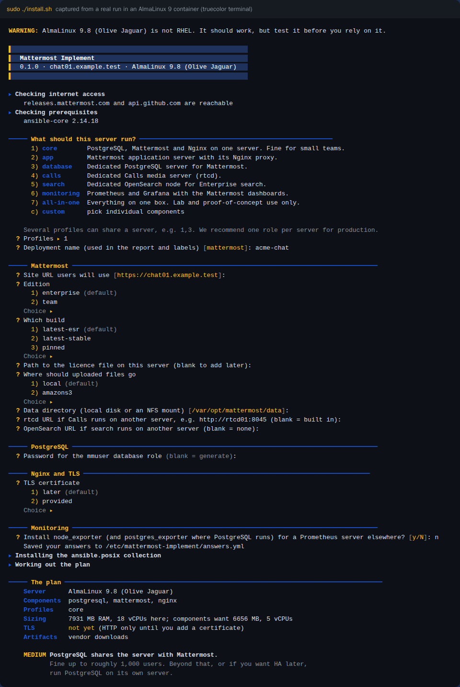

## Contents

- [Quick start](#quick-start)
- [What it can install](#what-it-can-install)
- [Ways to install](#ways-to-install)
- [Where installers come from](#where-installers-come-from)
- [Versions we deploy](#versions-we-deploy)
- [What happens on each server](#what-happens-on-each-server)
- [Monitoring, alerts and dashboards](#monitoring-alerts-and-dashboards)
- [What's left for the admin](#whats-left-for-the-admin)
- [Testing the toolkit](#testing-the-toolkit)
- [Repository layout](#repository-layout)

## Quick start

On the target server, as root:

```bash
git clone <this repo> /opt/mattermost-implement
cd /opt/mattermost-implement
./install.sh
```

The script then:

1. checks this is RHEL 9 or 10,
2. asks before checking it can reach the vendors' download sites, and falls back to a local
   folder if it can't,
3. installs `ansible-core` and the `ansible.posix` collection,
4. asks what this server should run and saves the answers to `/etc/mattermost-implement/answers.yml`,
5. shows the plan, with any warnings about putting too much on one box, and waits for a yes,
6. deploys, runs the post-deploy tests and writes the architecture document.

Run it again whenever you like. The roles are idempotent, so a second run changes nothing unless
something has drifted, and you get a fresh report. An installed Mattermost stays on its version
until you ask for an upgrade with `--upgrade`; see [Layout and upgrades](#layout-and-upgrades).

## What it can install

Each component is an Ansible role. Exporters are added automatically next to whatever they
watch, so you don't pick them yourself.

| Component | Role | What it's for |
|---|---|---|
| Mattermost (Enterprise or Team) | `mattermost` | The application server |
| PostgreSQL | `postgresql` | Mattermost's database |
| Nginx | `nginx` | Reverse proxy and TLS termination |
| Calls media server | `rtcd` | Audio, video and screen share for Mattermost Calls |
| OpenSearch | `opensearch` | Enterprise search, with the analysis-icu plugin |
| Prometheus | `prometheus` | Collects metrics from every server |
| Grafana | `grafana` | Dashboards and alerting |
| node_exporter | `node_exporter` | Host metrics, on every server that's monitored |
| postgres_exporter | `postgres_exporter` | Added next to PostgreSQL |
| nginx-prometheus-exporter | `nginx_exporter` | Added next to Nginx |
| elasticsearch_exporter | `opensearch_exporter` | Added next to OpenSearch |
| blackbox_exporter | `blackbox_exporter` | On the monitoring server: checks the site, its certificate and the Calls port from outside |

Three more roles do the plumbing. `common` handles OS checks, firewall rules, SELinux, fapolicyd
and working out how the pieces connect. `artifacts` finds, downloads and verifies the tarballs,
and `report` writes the architecture document.

Roles are grouped into profiles. Give a server one profile, several, or a custom list:

| Profile | Components | Typical use |
|---|---|---|
| `core` | postgresql, mattermost, nginx | Small teams, one server |
| `app` | mattermost, nginx | Application server in a split estate |
| `database` | postgresql | Dedicated database server, or a read replica of one |
| `calls` | rtcd | Dedicated Calls server |
| `search` | opensearch | Dedicated search server |
| `monitoring` | prometheus, grafana | Watches the rest of the estate |
| `all-in-one` | everything | Labs and proofs of concept only |

You can put everything on one box. The installer tells you why that's a bad idea before it starts
(OpenSearch fighting Mattermost for memory, monitoring living on the thing it monitors, and so on),
and the report repeats it under Risks.

## Ways to install

### Interactively

Just run `./install.sh`. It asks for the profile, the site URL, which Mattermost build you want,
where uploaded files go, TLS, and whatever the chosen components need. Passwords left blank are
generated and kept in `/etc/mattermost-implement/secrets.yml` (root only).

### From an answer file

Copy [answers.example.yml](answers.example.yml), which documents every setting, and run:

```bash
./install.sh --answers /root/chat-prod.yml
```

Nothing is asked that the answer file already settles. Add `--non-interactive --yes` for fully
unattended runs.

### From flags

```bash
./install.sh --profile core --non-interactive --yes
./install.sh --profile app,calls --answers /root/app01.yml
./install.sh --components postgresql,node_exporter --answers /root/db01.yml
```

The other flags:

| Flag | Does |
|---|---|
| `--plan-only` | Shows what would happen, then stops |
| `--upgrade` | Lets an installed Mattermost (and rtcd) move to the newest release on its channel |
| `--check` | Dry run |
| `--verify-only` | Re-runs the post-deploy tests and refreshes the report |
| `--report-only` | Rebuilds the report from the last results |
| `--offline-dir DIR\|URL` | Uses a local copy of the installers |
| `--local-repo PATH` | Adds a mounted RHEL ISO as a temporary dnf repo |
| `--online`, `--offline` | Skips the connectivity question |

### Example: one server for a small team

```yaml
deploy_name: acme-chat
deploy_profiles: [core]
mattermost_site_url: https://chat.acme.example
mattermost_version_channel: latest-esr
tls_mode: provided
tls_cert_file: /root/certs/chat.acme.example.crt
tls_key_file: /root/certs/chat.acme.example.key
```

### Example: a split estate

Five servers, each with its own answer file. The pieces find each other through the `*_host`,
`*_url`, `*_sources` and `*_allowed_clients` settings.

```yaml
# db01 (10.10.1.11)
deploy_profiles: [database]
postgresql_allowed_clients: [10.10.1.12]
deploy_monitoring_exporters: true
monitoring_scrape_sources: [10.10.1.15]
```

```yaml
# app01 (10.10.1.12)
deploy_profiles: [app]
mattermost_site_url: https://chat.acme.example
mattermost_db_host: 10.10.1.11
mattermost_db_password: "<copied from secrets.yml on db01>"
mattermost_rtcd_url: http://10.10.1.13:8045
mattermost_opensearch_url: https://10.10.1.14:9200
mattermost_opensearch_password: "<copied from secrets.yml on search01>"
mattermost_opensearch_ca_file: /root/search-ca.pem
tls_mode: provided
tls_source_dir: /root/certs
deploy_monitoring_exporters: true
monitoring_scrape_sources: [10.10.1.15]
```

```yaml
# calls01 (10.10.1.13)
deploy_profiles: [calls]
rtcd_api_sources: [10.10.1.12]
rtcd_ice_host_override: 203.0.113.20     # the address clients use
deploy_monitoring_exporters: true
monitoring_scrape_sources: [10.10.1.15]
```

```yaml
# search01 (10.10.1.14)
deploy_profiles: [search]
opensearch_allowed_clients: [10.10.1.12]
deploy_monitoring_exporters: true
monitoring_scrape_sources: [10.10.1.15]
```

```yaml
# mon01 (10.10.1.15)
deploy_profiles: [monitoring]
monitoring_site_url: https://chat.acme.example
monitoring_estate:
  - {name: db01, address: 10.10.1.11, components: [postgresql]}
  - {name: app01, address: 10.10.1.12, components: [mattermost, nginx]}
  - {name: calls01, address: 10.10.1.13, components: [rtcd]}
  - {name: search01, address: 10.10.1.14, components: [opensearch]}
```

Install the database, Calls and search servers first, in any order, then the app server, then
monitoring. The app server needs the database password from db01's secrets file, and the search CA
(`/etc/opensearch/certs/root-ca.pem`) copied over from search01.

Anything only local components use stays on 127.0.0.1 with no firewall opening. Anything another
server needs is opened to the addresses you list, and nothing else. A database server without
Mattermost stops at validation if `postgresql_allowed_clients` is empty, since nothing could reach
it. Entries may be CIDRs, and `0.0.0.0/0` allows any address.

The database server sizes `max_connections` for every app server in `postgresql_allowed_clients`:
`mattermost_db_max_open_conns` (300, Mattermost's own default) for each, plus 50 spare. If you
list a subnet rather than single addresses, set `postgresql_app_servers` to the number of
Mattermost servers behind it. If you change `mattermost_db_max_open_conns`, set it on the
database server too.

### Example: a database with a read replica

A read replica is a read-only copy of the database that follows the primary as it changes.
Mattermost Enterprise sends some of its reads there, which takes load off the primary. It won't
fail over by itself: if the primary is lost, you promote the replica by hand. The report on the
replica has the command.

```yaml
# db01 (10.10.1.11), the primary
deploy_profiles: [database]
postgresql_replication: primary
postgresql_replica_hosts: [10.10.1.21]
postgresql_allowed_clients: [10.10.1.12]
```

```yaml
# db02 (10.10.1.21), the replica
deploy_profiles: [database]
postgresql_replication: replica
postgresql_primary_host: 10.10.1.11
postgresql_allowed_clients: [10.10.1.12]
mattermost_db_password: "<db_password from db01's secrets.yml>"
postgresql_replication_password: "<replication_password from db01's secrets.yml>"
```

```yaml
# and on app01
mattermost_db_replica_hosts: [10.10.1.21]
```

Install db01 first. On its first run db02 copies db01 with `pg_basebackup`, then keeps following
it. It stops rather than overwrite a data directory that already holds a database of its own.
Give both servers the same `postgresql_allowed_clients` and `mattermost_db_max_open_conns`. A
replica won't start with a lower `max_connections` than its primary, so the installer raises it
to match if it has to.

Each replica holds a replication slot on the primary, and the primary keeps WAL until the replica
has received it. A replica that stays down would make the primary keep WAL until its disk filled,
so `max_slot_wal_keep_size` caps how much one slot can hold. The default cap is 20% of the
filesystem under the primary's data directory (`postgresql_slot_wal_keep_pct`), or you can give a
size in MB with `postgresql_max_slot_wal_keep_size`. A replica that falls past the cap can't catch
up and has to be rebuilt: stop PostgreSQL on it, move `/var/lib/pgsql/data` aside and run
`install.sh` again. The monitoring server warns long before that point.

A server without replicas needs none of this. With no slots, PostgreSQL recycles WAL at every
checkpoint and keeps around `max_wal_size` of it (1 GB by default).

### Example: no internet access

On a machine that does have internet access:

```bash
tools/build-offline-bundle.sh --arch amd64 --edition enterprise --channel both --with-rpms
```

Carry `mm-bundle-<date>.tar.gz` across, unpack it and run:

```bash
./install.sh --offline-dir /srv/mm-bundle-20261029
```

`--channel both` puts the latest stable and the latest ESR in the bundle, so you can still choose
on the day. [docs/offline.md](docs/offline.md) covers the bundle layout, hand-filled folders and
internal mirrors.

## Where installers come from

Before downloading anything, the installer lists the sites it needs and asks whether it may check
them. It checks them all at once (through `https_proxy` if you've set one) and shows the result.

| Site | What we get there |
|---|---|
| releases.mattermost.com | Mattermost server tarballs and their GPG signatures |
| docs.mattermost.com | The version archive: which release is the latest stable and which is the latest ESR, with their SHA-256 checksums |
| github.com | rtcd, Prometheus and the exporters, plus their published checksum files |
| release-assets.githubusercontent.com | Where GitHub actually serves those downloads from |
| api.github.com | Looking up "latest" versions (rtcd by default). Pinned versions don't use it. |
| artifacts.opensearch.org | OpenSearch, its ICU plugin, their signatures and SHA-512 checksums |
| dl.grafana.com | The Grafana tarball |
| grafana.com | Grafana's download API, for the checksum |
| galaxy.ansible.com | The `ansible.posix` collection Ansible needs |

PostgreSQL and Nginx come from your own dnf repositories (RHEL CDN, Satellite, a mirror or a
mounted ISO), so they get RHEL errata like everything else on the box.

If you say no to the check, or any site fails, it asks for a folder or mirror instead, shows what
it found there and asks you to confirm. If only some sites fail you can choose to carry on
online, for example when the failed ones serve components this server doesn't run.

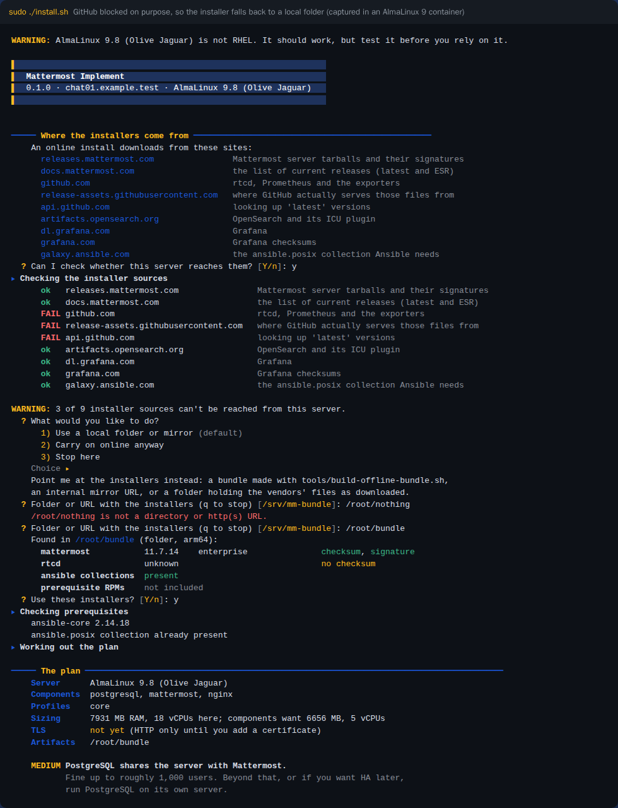

An answer file settles all this without questions:

| `deploy_internet` | What happens |
|---|---|
| `auto` | Checks the sites and downloads. If `artifact_source` is set, uses that instead. |
| `yes` | Doesn't check, just downloads. |
| `no` | Uses `artifact_source`. Asks for it interactively if it's empty; an unattended run stops. |
| left out | Asks permission first, as above. |

### How downloads are checked

Every tarball is checked before it's unpacked. If a check fails the install stops, and the file
stays in `/var/cache/mattermost-implement` for you to look at.

| Download | Checked against |
|---|---|
| Mattermost | GPG signature with Mattermost's key (`A1B31D46F0F3A10B02CF2D44F8F2C31744774B28`), plus the SHA-256 from the version archive |
| OpenSearch and its ICU plugin | GPG signature with OpenSearch's key (`C5B7498965EFD1C2924BA9D539D319879310D3FC`), plus the vendor's SHA-512 |
| Everything else | The vendor's published SHA-256 |

The keys are held in this repo. We never trust a key that came from the download source.

## Versions we deploy

Mattermost and rtcd follow the latest release by default when they're first installed. After that,
re-runs keep the installed version until you pass `--upgrade`. Everything else is pinned in
[inventory/group_vars/all/defaults.yml](inventory/group_vars/all/defaults.yml), so an install
today and an install next month get the same thing. Change any of them in the answer file; most
accept `latest`.

| Component | Setting | Default | What that was on 29 October 2026 |
|---|---|---|---|
| Mattermost | `mattermost_version_channel` | `latest-stable` (the installer suggests `latest-esr`) | 12.0.1 stable, 11.7.14 ESR |
| rtcd | `rtcd_version` | `latest` | 1.2.6 |
| PostgreSQL | `postgresql_version` | `16` from AppStream | 16.15 on RHEL 9.8 |
| Nginx | `nginx_module_stream` | RHEL's default stream | 1.20.1 on RHEL 9.8 |
| OpenSearch | `opensearch_version` | `2.19.7` | pinned |
| Prometheus | `prometheus_version` | `3.15.1` | pinned |
| node_exporter | `node_exporter_version` | `1.12.1` | pinned |
| postgres_exporter | `postgres_exporter_version` | `0.20.1` | pinned |
| nginx-prometheus-exporter | `nginx_exporter_version` | `1.5.3` | pinned |
| elasticsearch_exporter | `opensearch_exporter_version` | `1.11.0` | pinned |
| blackbox_exporter | `blackbox_exporter_version` | `0.29.1` | pinned |
| Grafana OSS | `grafana_version` | `13.3.0` | pinned |
| ansible.posix | `requirements.yml` | `>=1.5.4,<2.0.0` | 1.6.2 |

Mattermost's ESR line is the safer choice for most customers. Stable gets new features every
month and has a shorter support window. Pin an exact build with
`mattermost_version_channel: pinned` and `mattermost_version: 11.7.14`.

On arm64 servers, Mattermost's tarballs ship without the prepackaged plugins, so Calls, Jira,
GitHub and the rest have to come from the Marketplace. The report flags this.

## What happens on each server

### Layout and upgrades

Tarball components unpack into `/opt/<name>-<version>`, with a symlink at `/opt/<name>` pointing
at the live one. Config lives in `/etc` and data in `/var`, outside the install directory.
Upgrading means changing the version and re-running: the new version unpacks next to the old one,
the symlink moves and the service restarts. Rolling back means pointing the symlink back.

Mattermost is handled more carefully, because its database migrations only go forwards:

- Once it's installed, re-runs stay on the installed version even when `latest-stable` or
  `latest-esr` has moved on. The plan says so. Pass `--upgrade` (or set
  `mattermost_allow_upgrade: true`) to move to the newest release. Changing a pinned
  `mattermost_version` is an upgrade by itself. rtcd on `latest` is held the same way.
- Before an upgrade, Mattermost is stopped and its database dumped with `pg_dump -Fc` to
  `/var/lib/mattermost-implement/backups`, next to a copy of `config.json`. On an app server with a
  remote database this installs the PostgreSQL client from the `postgresql_version` stream, which
  must be the database server's major version or newer. If the dump fails, Mattermost restarts on
  the old version and the run stops. Uploaded files aren't copied, so back those up yourself.
  `mattermost_upgrade_backup: false` skips the dump if you've just taken your own backup.
- An older version than the one installed is refused. Going back means restoring the dump, then
  pointing the symlink back by hand.

Mattermost reads `/etc/mattermost/config.json`. We only set the keys we own (site URL, database,
file storage, paths, metrics, search and Calls), so everything else stays editable in the System
Console.

### Security defaults

SELinux stays enforcing and firewalld stays on. Where fapolicyd runs, our install directories get
trust entries so it can stay on too. OpenSearch uses certificates from its own
CA, never the public demo ones. PostgreSQL uses SCRAM-SHA-256, with TLS on a self-signed
certificate once remote clients or replicas are allowed. Replicas log in as a separate
`replicator` user, which pg_hba.conf only lets in for replication. Each replica makes its own
certificate rather than keeping the copy of the primary's key. Generated passwords live in
`/etc/mattermost-implement/secrets.yml`, root only.

### Post-deploy tests

Every role carries its own checks. They run at the end of every install, and again whenever you
run `./install.sh --verify-only`. They cover:

- services and ports, and Mattermost's health API,
- database logins, and on replicated databases that the replica is streaming and every slot
  is in use,
- the certificate and websocket upgrades through Nginx,
- Calls and search reachability,
- scrape targets, and the alert rules and dashboards in Grafana.

A failed critical check fails the run, but only after the report has been written, so you always
get a document that says what went wrong. [docs/testing.md](docs/testing.md) lists every check.

### The architecture document

Each run writes `/var/lib/mattermost-implement/reports/latest.md`. It has Mermaid diagrams of the
components, traffic and request flow, and the server's spec. It gives every component's version,
checksum, paths and ports, plus the firewall matrix, security notes and backup guidance. It also
records the monitoring estate and alert counts, every test result, risks and design decisions,
and an operations runbook. Test results are also kept as JSON in
`/var/lib/mattermost-implement/results/`.

## Monitoring, alerts and dashboards

When a server takes the `monitoring` profile, the installer offers to build monitoring for the
whole estate. It asks for each server's name, address and what it runs, and builds everything
below from that list. Only modules that actually exist get alerts and dashboards.

### What gets collected

| From | How | Port |
|---|---|---|
| Every server | node_exporter, including the state of our systemd services | 9100 |
| Mattermost | its built-in metrics | 8067 |
| PostgreSQL | postgres_exporter, over the local socket | 9187 |
| Nginx | nginx-prometheus-exporter reading stub_status on 127.0.0.1:81 | 9113 |
| OpenSearch | elasticsearch_exporter, over TLS with the search CA | 9114 |
| rtcd | its built-in metrics | 8045 |
| Prometheus and Grafana | their own metrics | 9090, 3000 |
| The site, as users see it | blackbox_exporter fetching `/api/v4/system/ping` and checking the certificate | local |
| Calls media port | blackbox_exporter opening a TCP connection to each rtcd server | local |

Prometheus scrapes every 30 seconds and keeps 15 days. Every target is labelled with its server's
name, so an alert says "disk 85% full on db01" rather than giving you an IP and a port.

### Dashboards

There are seven dashboards, generated for the estate, linked to each other and coloured to match
the alert tiers: green, then blue for info, yellow for warning and red for critical. Mattermost's
own community dashboards sit in a separate folder.

#### Estate overview

Is the site up, how fast is it, when does the certificate expire, what's down and what's firing.

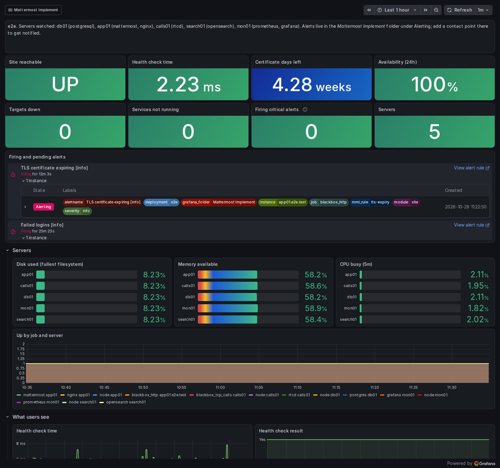

#### Servers

CPU, load, memory, swap, disk usage and a 24-hour forecast, disk I/O, network and UDP errors,
clock offset, file descriptors and service state, for one server or all of them.

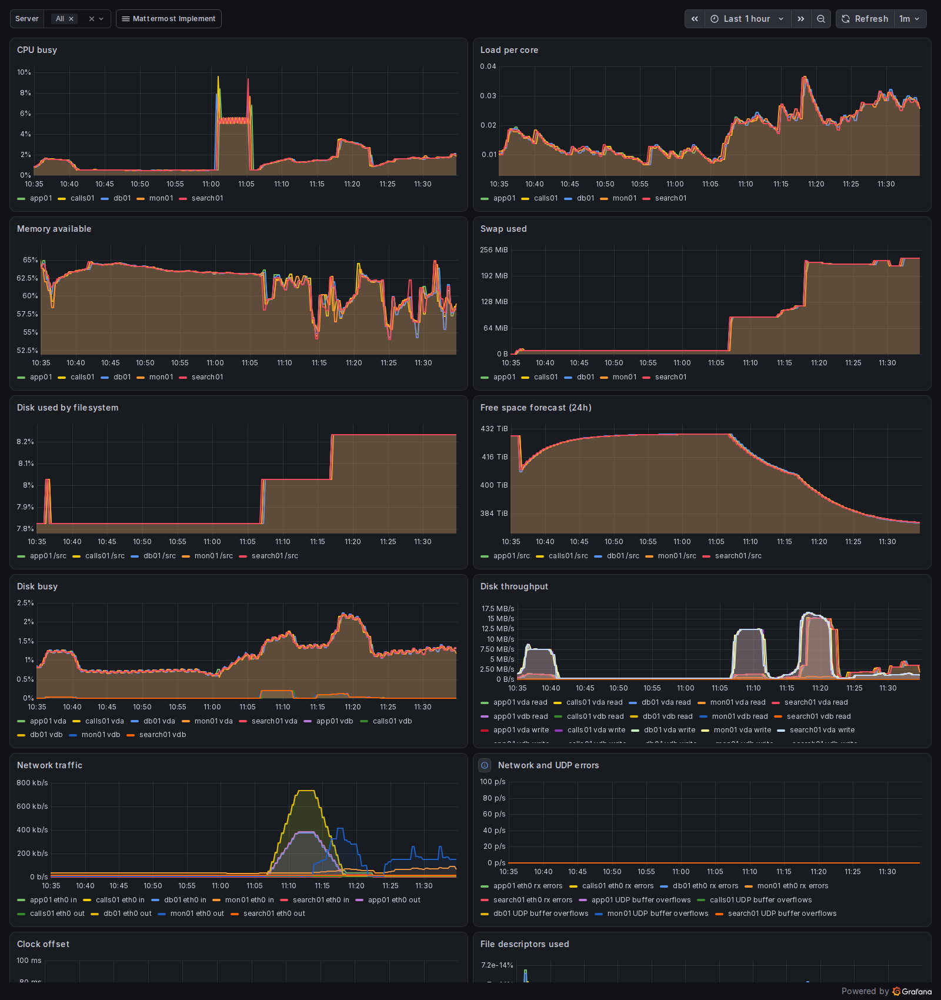

#### Mattermost

API error rate and latency, the slowest handlers, websocket connections, logins and failures,
push notifications, the database pool and the Go heap.

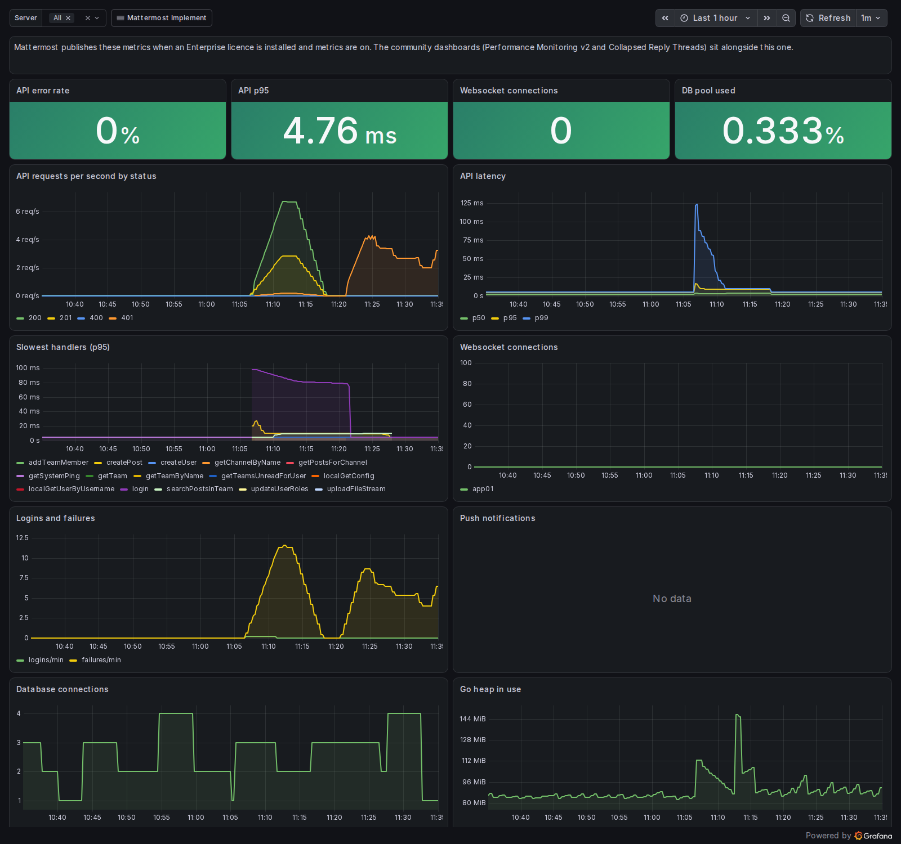

#### PostgreSQL

Connections by state, transactions, the longest open transaction, rows read and written, locks,
deadlocks, cache hit ratio and database size. With a read replica it also shows replication lag
and how much WAL the primary is holding for each replica, against the cap.

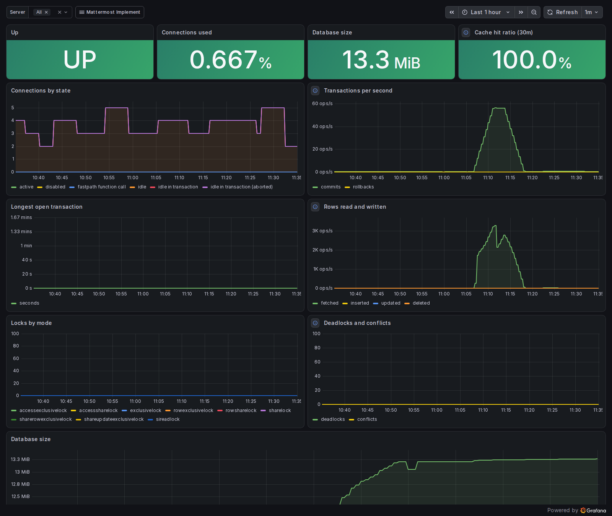

#### OpenSearch

Cluster status, heap, data disk, document count, search and indexing rates, rejected work and
GC time.

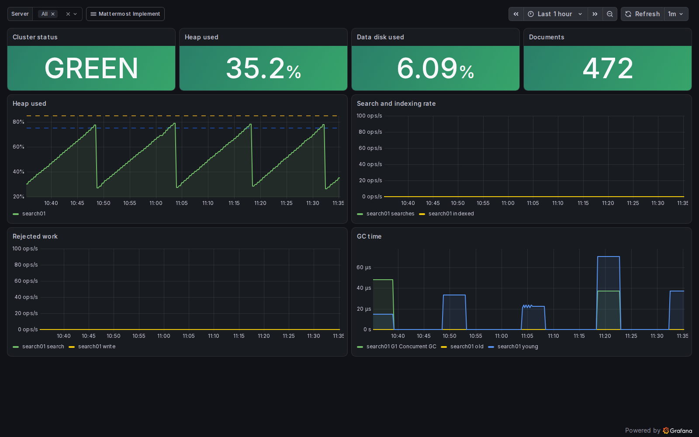

#### Calls

Active sessions, rtcd CPU and memory, file descriptors, UDP buffer overflows, media errors, and
client packet loss and round-trip time. The session and client panels fill in once people start
making calls.

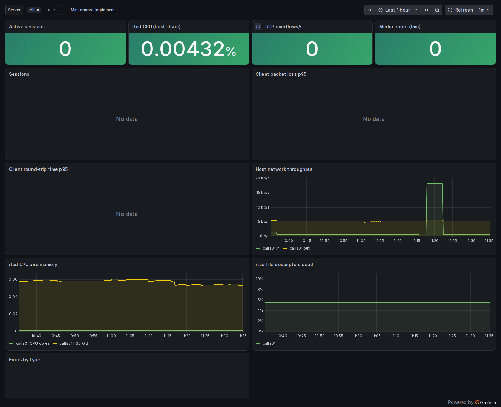

#### Nginx

Connections by state, requests per second and dropped connections.

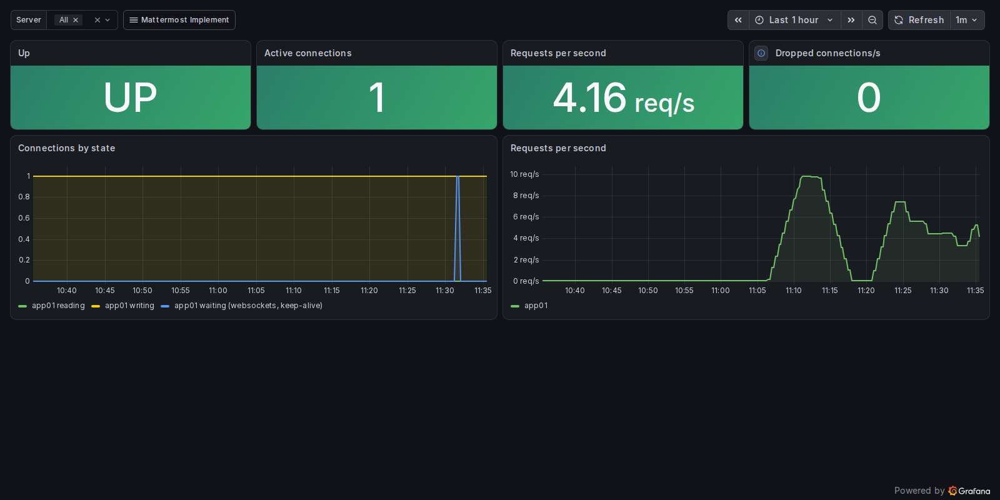

### Alerts

There are 56 checks, which become 117 Grafana alert rules for a full estate: 45 critical,
41 warning and 31 info. Each check has up to three tiers and they never overlap. A disk at 85%
fires the warning only, and at 96% the critical only, so one problem raises one alert.

Every rule carries these labels, which is what you route on:

| Label | Values |
|---|---|
| `severity` | `info`, `warning`, `critical` |
| `module` | `host`, `site`, `mattermost`, `postgresql`, `nginx`, `opensearch`, `rtcd`, `monitoring` |
| `mmi_rule` | the check's id, as in the tables below |
| `deployment` | `deploy_name` from the answer file |

Each alert's description says what to do when it fires. Rules with no data stay quiet, for example
a module with no traffic yet, or Mattermost metrics without a licence. If a query fails outright,
Grafana raises its own DatasourceError alert, so a dead Prometheus doesn't go unnoticed.

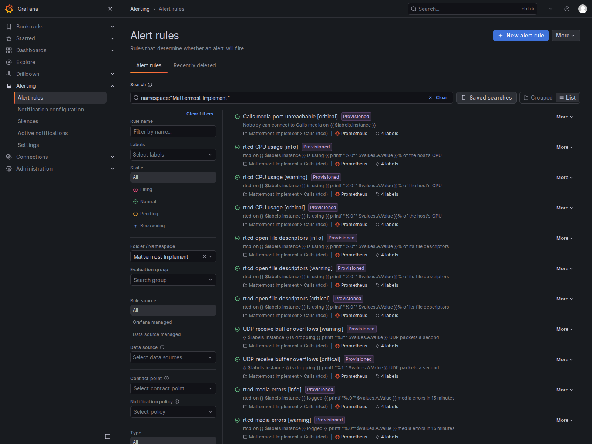

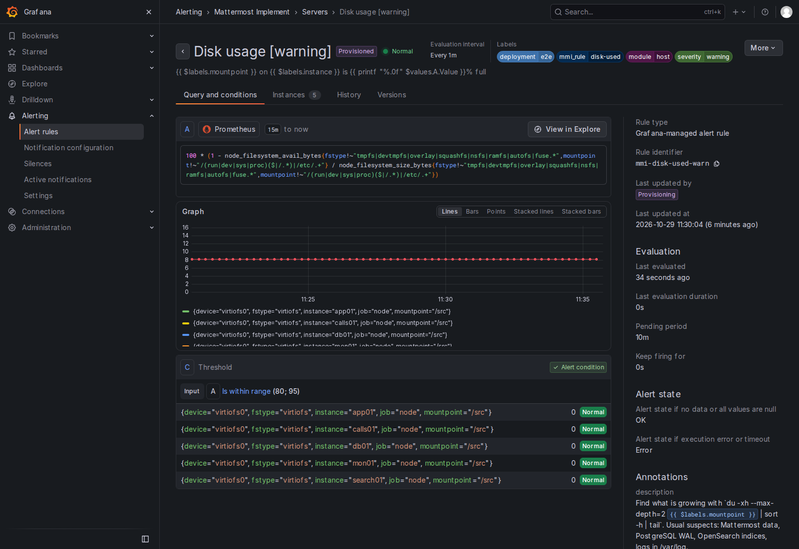

Change thresholds in the answer file and re-run on the monitoring server. The rules are
provisioned from files, so edits made in the Grafana UI won't stick.

```yaml
monitoring_alert_overrides:
  disk-used: {tiers: {info: 75, warning: 85}}   # move tiers
  cpu-busy: {for: 30m}                          # wait longer before firing
  swap-used: {tiers: {info: null}}              # drop a tier
monitoring_alerts_disabled: [host-rebooted]      # drop a check completely
```

### Every check

`<` means the alert fires when the value drops below the threshold. The id after each name is
what the overrides above use. The same tables are in [docs/alerts.md](docs/alerts.md).

<!-- alerts:start (generated from tools/alert_catalogue.py; tests fail if this drifts) -->

#### Servers alerts

| Check | Info | Warning | Critical | For | What to do |
|---|---|---|---|---|---|
| Metrics target down `target-down` |  |  | < 1 | 3m | The server or the exporter is down, or the firewall is blocking the scrape. Check `systemctl status` for the service on that host, then `firewall-cmd --list-all`. |
| Mattermost Implement service not running `service-not-active` |  |  | < 1 | 2m | Run `systemctl status {{ $labels.name }}` and `journalctl -u {{ $labels.name }} -n 100` on the host. |
| Disk usage `disk-used` | > 70% | > 80% | > 95% | 10m | Find what is growing with `du -xh --max-depth=2 {{ $labels.mountpoint }} \| sort -h \| tail`. Usual suspects: Mattermost data, PostgreSQL WAL, OpenSearch indices, logs in /var/log. |
| Disk predicted full within 24 hours `disk-fills-24h` |  | < 0 GiB |  | 30m | Growth over the last 6 hours points to a full disk tomorrow. Find the cause before the usage alerts start. |
| Disk predicted full within 4 hours `disk-fills-4h` |  |  | < 0 GiB | 10m | Act now: free space or extend the volume. A full disk stops PostgreSQL and Mattermost. |
| Inode usage `inodes-used` | > 70% | > 80% | > 95% | 10m | Lots of small files. Check plugin caches, session files and log rotation. |
| Filesystem went read-only `filesystem-readonly` |  |  | > 0 | 1m | Usually a storage error. Check `dmesg` and the storage team before anything writes there again. |
| Memory available `memory-available` | < 20% | < 10% | < 5% | 10m | Check which process has grown with `ps aux --sort=-rss \| head`. On shared boxes OpenSearch's heap is the usual culprit. |
| Swap usage `swap-used` | > 25% | > 50% | > 80% | 15m | Sustained swapping slows everything on the host. Add memory or move a component elsewhere. |
| Out-of-memory kill `oom-kill` |  |  | > 0 | 0s | Find the victim with `journalctl -k \| grep -i 'killed process'` and check the service it belonged to restarted. |
| CPU usage `cpu-busy` | > 70% | > 85% | > 95% | 15m | Check `top`. Busy calls (rtcd), bulk indexing (OpenSearch) and big imports are the common causes. |
| Load per CPU core `load-per-core` | > 1 | > 1.5 | > 2.5 | 15m | High load with idle CPU usually means processes waiting on disk. Check `iostat -x 5`. |
| Disk I/O saturation `disk-io-busy` | > 60% | > 80% | > 95% | 15m | The disk can't keep up. PostgreSQL and OpenSearch suffer first. Look at the storage tier or spread the load. |
| Open file descriptors `fd-used` | > 70% | > 80% | > 95% | 10m | Look for a leak with `lsof \| awk '{print $1}' \| sort \| uniq -c \| sort -n \| tail`. |
| Clock drift `clock-offset` | > 50 ms | > 100 ms | > 500 ms | 10m | Check `chronyc tracking` and that the NTP servers are reachable. Drift breaks TLS and confuses message order. |
| Clock not synchronised `clock-unsynced` |  | < 1 |  | 15m | Run `chronyc sources -v` and fix NTP reachability. |
| Network interface errors `network-errors` |  | > 1/s | > 10/s | 10m | Check the NIC and switch port. Errors here show up as slow pages and broken calls. |
| Server restarted `host-rebooted` | < 15 min |  |  | 0s | Expected if it was patched. If not, find out why with `journalctl -b -1 -n 200`. |
| systemd unit failed `systemd-unit-failed` |  | > 0 |  | 5m | Run `systemctl status {{ $labels.name }}`. Clear it with `systemctl reset-failed` once fixed. |

#### Site availability alerts

| Check | Info | Warning | Critical | For | What to do |
|---|---|---|---|---|---|
| Mattermost site unreachable `site-down` |  |  | < 1 | 2m | Users can't reach Mattermost. Check Nginx, then Mattermost, then the database, in that order. |
| Mattermost site slow to respond `site-slow` | > 1 s | > 2 s | > 5 s | 10m | Check database latency and app server CPU. Slow health checks come before user complaints. |
| TLS certificate expiring `tls-expiry` | < 30 days | < 14 days | < 7 days | 1h | Renew it, put it where tls_cert_file points and re-run install.sh on the app servers. |

#### Mattermost alerts

| Check | Info | Warning | Critical | For | What to do |
|---|---|---|---|---|---|
| Mattermost API errors `mm-api-errors` | > 1% | > 5% | > 10% | 10m | Look for the error in /var/log/mattermost/mattermost.log. Database and file store problems are the usual cause. |
| Mattermost API latency (p95) `mm-api-latency` | > 1 s | > 2 s | > 5 s | 10m | Check database CPU and slow queries (pg_stat_statements), then app server CPU. |
| Mattermost database connection pool `mm-db-connections` | > 70% | > 85% | > 95% | 10m | Requests will queue when the pool is full. Look for slow queries before raising SqlSettings.MaxOpenConns. |
| Failed logins `mm-login-failures` | > 25 | > 100 | > 500 | 0s | A spike can be password spraying. Check the audit log for source addresses and consider rate limiting. |
| Push notification errors `mm-push-errors` |  | > 10 | > 100 | 0s | Check the push proxy settings and that the server can reach push.mattermost.com (or your own proxy). |
| Mattermost can't write its logs `mm-logger-errors` |  | > 0 |  | 0s | Usually a full or read-only log directory. Check /var/log/mattermost. |
| Mattermost restarted `mm-restarted` | > 0 |  |  | 0s | Expected after an upgrade or config change. If not, check `journalctl -u mattermost` for a crash. |

#### PostgreSQL alerts

| Check | Info | Warning | Critical | For | What to do |
|---|---|---|---|---|---|
| PostgreSQL down `pg-down` |  |  | < 1 | 1m | Mattermost stops working without its database. Check `systemctl status postgresql` and the log in the data directory. |
| PostgreSQL connections `pg-connections` | > 70% | > 80% | > 90% | 10m | New connections will be refused when this hits 100%. Look for idle sessions and app servers with oversized pools. |
| Long-running PostgreSQL transaction `pg-long-transaction` | > 300 s | > 900 s | > 3600 s | 2m | Long transactions block vacuum and can lock tables. Find it in pg_stat_activity and decide whether to cancel it. |
| PostgreSQL deadlocks `pg-deadlocks` |  | > 0 | > 10 | 0s | Check the PostgreSQL log for the statements involved. Report repeat offenders to Mattermost support. |
| PostgreSQL cache hit ratio `pg-cache-hit` | < 99% | < 95% | < 90% | 30m | The working set no longer fits in shared_buffers. Add memory or move PostgreSQL to its own server. |
| PostgreSQL rollback rate `pg-rollbacks` | > 5% | > 15% |  | 15m | Some rollbacks are normal. A rise usually matches errors in the Mattermost log. |
| Sessions idle in transaction `pg-idle-in-transaction` |  | > 10 | > 50 | 5m | These hold locks and connections. idle_in_transaction_session_timeout should clear them; find the client if it doesn't. |
| PostgreSQL replica lag `pg-replication-lag` | > 60 s | > 300 s | > 1800 s | 5m | Reads Mattermost sends to the replica are this far out of date. Check disk I/O on the replica and the network to the primary, and run `SELECT * FROM pg_stat_wal_receiver` on the replica. |
| PostgreSQL replica disconnected `pg-replica-disconnected` |  | < 1 |  | 5m | The replica is down or can't reach the primary. Until it reconnects the primary keeps WAL for it, up to max_slot_wal_keep_size. Check `systemctl status postgresql` and the log on the replica. |
| WAL held for a PostgreSQL replica `pg-slot-wal-held` | > 25% | > 50% | > 80% | 5m | The replica is down or far behind. At 100% PostgreSQL gives the slot up to save the primary's disk, and the replica has to be rebuilt. Bring the replica back, or if it's gone for good run `SELECT pg_drop_replication_slot('<slot>')` on the primary to free the WAL now. |
| PostgreSQL replica can't catch up `pg-slot-lost` |  |  | > 0 | 1m | The replica can't catch up any more, so rebuild it. On the replica, stop postgresql, move the data directory aside and run install.sh again. It drops the old slot and takes a fresh copy. |

#### Nginx alerts

| Check | Info | Warning | Critical | For | What to do |
|---|---|---|---|---|---|
| Nginx down `nginx-down` |  |  | < 1 | 1m | Check `systemctl status nginx` and `nginx -t`. |
| Nginx dropping connections `nginx-dropped` |  | > 0/s | > 5/s | 5m | Nginx has run out of worker connections or file descriptors. Raise worker_connections and LimitNOFILE. |

#### OpenSearch alerts

| Check | Info | Warning | Critical | For | What to do |
|---|---|---|---|---|---|
| OpenSearch not answering `os-unreachable` |  |  | < 1 | 2m | Search falls back to the database or fails. Check `systemctl status opensearch` and its log. |
| OpenSearch cluster red `os-red` |  |  | > 0 | 2m | Some primary shards are missing, so search results are incomplete. Check `_cluster/allocation/explain`. |
| OpenSearch cluster yellow `os-yellow` | > 0 |  |  | 30m | Replica shards have nowhere to go. Normal on a single node; on a cluster it means a node is missing. |
| OpenSearch JVM heap `os-heap` | > 75% | > 85% | > 95% | 10m | Sustained high heap means long GC pauses and then crashes. Raise opensearch_heap_mb if the host has the RAM. |
| OpenSearch data disk `os-disk` | > 75% | > 85% | > 90% | 10m | At 85% OpenSearch stops placing replicas, at 90% it moves shards away and at 95% indices go read-only. |
| OpenSearch rejecting work `os-rejections` |  | > 0/s | > 5/s | 5m | Searches or index updates are being dropped. The node is overloaded; add CPU or heap. |

#### Calls (rtcd) alerts

| Check | Info | Warning | Critical | For | What to do |
|---|---|---|---|---|---|
| Calls media port unreachable `calls-port-unreachable` |  |  | < 1 | 3m | Calls will connect but carry no audio. Check rtcd is running and the firewall allows the media port. |
| rtcd CPU usage `rtcd-cpu` | > 60% | > 80% | > 95% | 10m | Calls will start to stutter. Add CPU or another rtcd server. |
| rtcd open file descriptors `rtcd-fds` | > 70% | > 80% | > 90% | 10m | rtcd opens a socket per connection. Raise LimitNOFILE in the rtcd unit, or add another rtcd server. |
| UDP receive buffer overflows `udp-buffer-errors` |  | > 0/s | > 50/s | 5m | Media packets are being lost before rtcd reads them. Check net.core.rmem_max and CPU on the host. |
| rtcd media errors `rtcd-errors` | > 10 | > 50 | > 200 | 0s | Check `journalctl -u rtcd` for the error types. Network paths and ICE settings are the usual cause. |
| Calls packet loss reported by clients `rtcd-packet-loss` | > 2% | > 5% | > 10% | 10m | Users will hear choppy audio. Check bandwidth to the rtcd server and UDP buffer overflows. |

#### Monitoring alerts

| Check | Info | Warning | Critical | For | What to do |
|---|---|---|---|---|---|
| Prometheus config reload failed `prometheus-config` |  | < 1 |  | 5m | Run `/opt/prometheus/promtool check config /etc/prometheus/prometheus.yml`, then fix and reload. |
| Scrapes taking too long `prometheus-scrape-slow` | > 5 s | > 10 s |  | 15m | The exporter or the network path is struggling. Dashboards and alerts lag behind reality. |

<!-- alerts:end -->

## What's left for the admin

The install leaves a working, tested and monitored estate. These are the jobs it can't do for you.

### Tell Grafana where to send alerts

The rules are evaluated from the moment Grafana starts, but they go nowhere until you add a
contact point. Grafana 13 starts with an empty one:

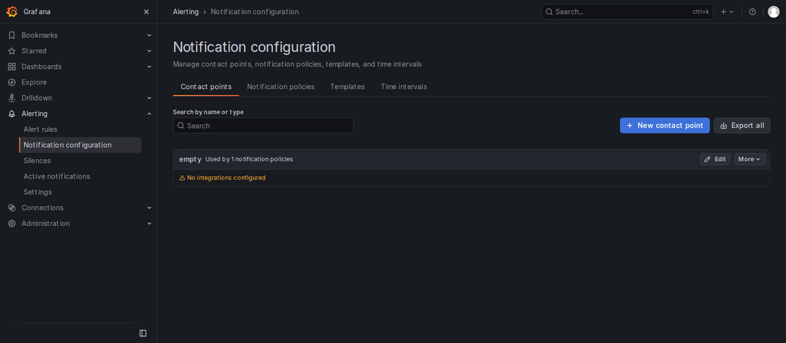

1. Log in to Grafana at `http://<monitoring server>:3000` as `admin`. The password is in
   `/etc/mattermost-implement/secrets.yml` on the monitoring server. Change it after you first
   log in.
2. Under Alerting > Contact points, add one for each place alerts should go.
   For email, configure SMTP in the `[smtp]` section of `/etc/grafana/grafana.ini` first and
   restart Grafana. For a Mattermost channel, create an incoming webhook in Mattermost
   (Integrations > Incoming Webhooks), then add a Slack contact point in Grafana with that
   webhook URL; Mattermost's incoming webhooks accept Slack-format messages. For on-call, use
   Grafana's built-in PagerDuty, Opsgenie or similar integrations.
3. Under Alerting > Notification policies, set the default policy, then add child policies that
   match on `severity`:

| Severity | Route to | Repeat interval |
|---|---|---|
| critical | On-call: phone, SMS or a paging tool | 1 hour |
| warning | The team's email or a Mattermost ops channel | 4 hours |
| info | A Mattermost channel or a daily digest. Never page for these. | 24 hours |

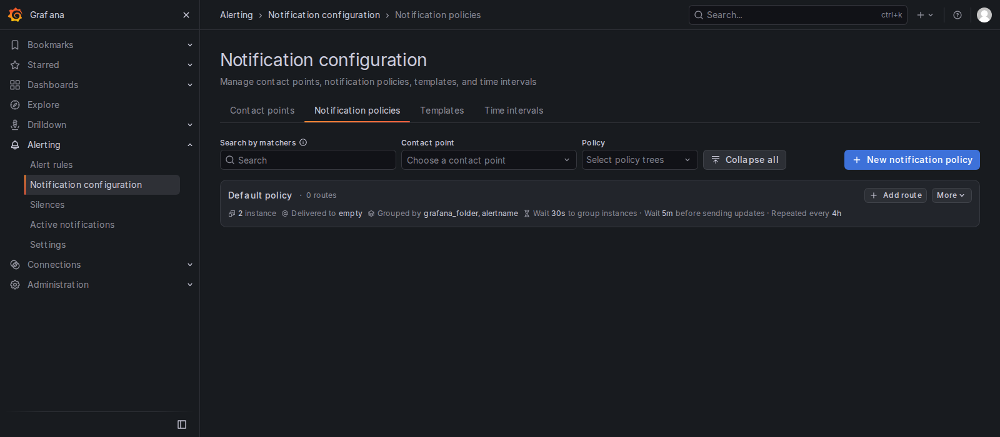

4. Grafana can't tell you when it's down itself. Point an external uptime check at
   `http://<monitoring server>:3000/api/health`.

### The rest of the checklist

| Job | Why |
|---|---|
| Add TLS if you installed with `tls_mode: later` | Mattermost is on plain HTTP until you do. Put the certificate and key on the app server, set `tls_mode: provided` and re-run. |
| Upload the Enterprise licence, or set `mattermost_license_file` | Until then Mattermost runs as a free instance, with Enterprise search and HA switched off. |
| Run a bulk index once licensed | System Console > Environment > Elasticsearch. Search uses the database until you do. |
| Set up SMTP and push notifications in the System Console | Invitations, password resets and mobile notifications depend on them. |
| With a read replica, plan how you'd fail over | Replication doesn't fail over by itself. Promote the replica with `pg_ctl promote` (the replica's report has the full command), then point `mattermost_db_host` at it and re-run the app servers. |
| Schedule backups and test a restore | `pg_dump` plus a file backup of the data directory, taken together and kept off the server. The report has the commands. |
| Set `rtcd_ice_host_override` behind NAT or a load balancer, and open UDP 8443 from clients | Otherwise calls connect but carry no audio. |
| Copy each server's `/etc/mattermost-implement/secrets.yml` somewhere safe | It holds the generated passwords. |
| Tune thresholds after a week | Use `monitoring_alert_overrides` for anything noisy. |
| On arm64 app servers, install plugins from the Marketplace | The arm64 tarball ships without Calls and the other bundled plugins. |

## Testing the toolkit

```bash
make venv     # once: a local virtualenv with ansible-core, ansible-lint, yamllint, shellcheck
make lint     # yamllint, ansible-lint (production profile), shellcheck, playbook syntax
make test     # unit tests and consistency checks (resolver, alert catalogue, docs, wrapper)
make render   # sample reports for eight layouts from made-up facts, in tests/render/out
make smoke    # the core profile in an AlmaLinux 9 container
make e2e      # five containers wired together, a functional test and a check of every alert query
make e2e-replica  # a PostgreSQL primary and read replica in two containers
```

The end-to-end test builds a database, app, Calls, search and monitoring server in containers and
installs each one with `install.sh`. It then logs in through Nginx over HTTPS, posts, uploads,
searches and opens a websocket. Finally it runs every alert rule's query against the live
Prometheus. It fails if any query returns no data, which usually means a wrong metric name, or if
anything critical is firing or pending. With `KEEP=true` the containers stay up and Grafana is on
http://localhost:13000. The screenshots in this README came from that estate, via
`tests/e2e/screenshots.py`.

`make e2e-replica` installs a primary and a replica, writes on one and reads it back from the
other, checks the exporters publish what the replication alerts query, then rebuilds the replica
from scratch and checks it streams again.

Containers can't show two things: SELinux is off inside them, and on Apple silicon they're arm64.
A release still needs a run on real RHEL 9 and 10 servers, online and offline.

## Repository layout

```text
install.sh                     the installer: sources, prerequisites, questions, plan, deploy
answers.example.yml            every setting, commented
inventory/group_vars/all/      defaults, component catalogue, profiles
playbooks/                     site, plan, verify, report
roles/<component>/             one role per component, each with tasks/verify.yml
roles/common/                  OS checks, selection, wiring, firewall and fapolicyd helpers
roles/artifacts/               resolve, download and verify tarballs; vendor GPG keys
roles/report/                  the architecture document
tools/resolve_versions.py      finds versions, URLs and checksums, online or offline
tools/build-offline-bundle.sh  builds an offline bundle
tools/alert_catalogue.py       every check and its thresholds
tools/observability.py         turns the estate into alert rules and dashboards
tests/                         unit, render, smoke and end-to-end tests
docs/                          alerts, offline installs, roles and testing
```

[docs/roles.md](docs/roles.md) explains how selection and wiring work, and how to add a profile
or a component.

## Requirements

- RHEL 9 or 10 on x86_64 or aarch64. Rocky and Alma work, but print a warning.
- Root.
- dnf repos for BaseOS and AppStream: subscription, Satellite, a mirror, or `--local-repo` with
  a mounted ISO.
- If you track `latest` for rtcd, OpenSearch or Grafana from a busy network, set `GITHUB_TOKEN`
  first. GitHub allows 60 anonymous API calls an hour per address.
