# Mattermost Parthenon

**Version 1.1.0**

> **Parthenon** /ˈpɑːθənɒn/ (n.) A temple built to house something important.

Parthenon installs Mattermost and the services around it on RHEL 9 or 10, Debian 12 or later, or
Ubuntu 24.04 or later, from the official tarballs. You run it on each server. It asks what that server should run, installs it, tests it and
writes an architecture document. On a monitoring server it also builds Prometheus, Loki, Grafana
dashboards and tiered alerts for the whole estate.

It doesn't provision servers or storage. The servers have to exist and be able to reach each other.
For a multi-server estate, `--preflight` checks that before you install anything.

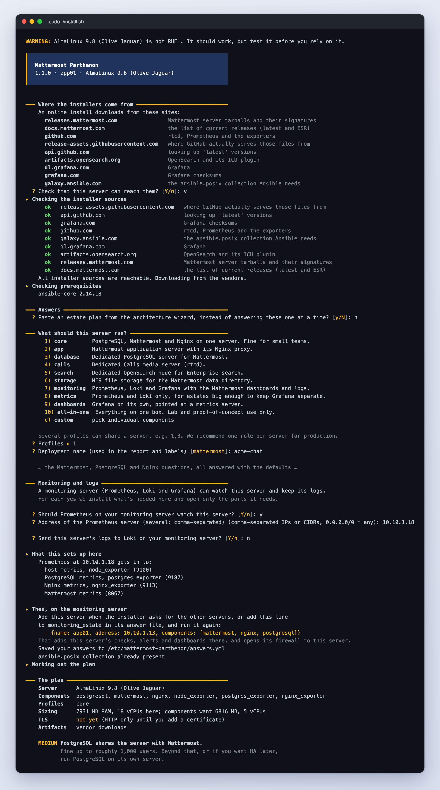

## Contents

- [Quick start](#quick-start)
- [The architecture wizard](#the-architecture-wizard)
- [Installing an estate](#installing-an-estate)
- [What it can install](#what-it-can-install)
- [Ways to install](#ways-to-install)
- [Taking components off a server](#taking-components-off-a-server)
- [Where installers come from](#where-installers-come-from)
- [Versions we deploy](#versions-we-deploy)
- [What happens on each server](#what-happens-on-each-server)
- [Monitoring, alerts and dashboards](#monitoring-alerts-and-dashboards)
- [What's left for the admin](#whats-left-for-the-admin)
- [Testing the toolkit](#testing-the-toolkit)
- [Repository layout](#repository-layout)

## Quick start

### One server

On the target server, as root:

```bash
git clone https://github.com/mm-tomreeve/implement.git /opt/mattermost-parthenon
cd /opt/mattermost-parthenon
./install.sh
```

It asks what the server should run, shows the plan, deploys, tests and writes the architecture
document. The roles are idempotent, so a second run changes nothing unless something has drifted.

### An estate

Plan it in the browser, then run the same few commands on each server.

1. Open [wizard/index.html](wizard/index.html), answer the questions, enter each server's address
   and copy the estate plan.
2. Make one set of passwords for the estate, on any machine:

   ```bash
   python3 tools/estate_plan.py new-secrets --out estate-secrets.yml
   ```

3. On each server, in the install order the wizard gave you:

   ```bash
   ./install.sh --estate my-estate.yml --preflight                        # can it reach the rest?
   ./install.sh --estate my-estate.yml --estate-secrets estate-secrets.yml
   ./install.sh --edit                                                    # certificates, licence, CA
   ```

Step 2 is optional. Without it each server generates its own passwords and you copy the database
one across by hand. `--edit` is only needed where something has to exist as a file on that server,
and the install tells you which.

### What a run does

1. Checks this is a supported RHEL, Debian or Ubuntu release.
2. Asks before checking it can reach the vendors' download sites, and falls back to a local folder
   if it can't.
3. Installs `ansible-core` and the `ansible.posix` collection.
4. Works out what this server should run and saves it to `/etc/mattermost-parthenon/answers.yml`.
5. Shows the plan, with warnings about putting too much on one box, and waits for a yes.
6. Deploys, runs the post-deploy tests and writes the architecture document.

An installed Mattermost stays on its version until you pass `--upgrade`. See
[Layout and upgrades](#layout-and-upgrades).

## The architecture wizard

[wizard/index.html](wizard/index.html) is a single page you open in a browser. Nothing you enter is
sent anywhere, and nothing is fetched either: the libraries and the typeface are in
[wizard/vendor](wizard/vendor/README.md), so the page works the same behind an air gap as it does
anywhere else. Copy the `wizard` folder about as one piece.

It is light by default. The moon/sun button in the banner switches to a dark theme, and the
wizard remembers your choice in that browser.

Give it the licence and seat count and it recommends a topology, draws it, works out the install
order and writes an **estate plan**: one encoded line describing every server. It also produces the
tables other teams ask for: inbound and outbound firewall rules for the network team, sizing for the
server team, and the design decisions behind the shape. All of them copy as Markdown.

### 1. The deployment

The first choice is what you are building: a **production estate**, one role per server, or a
**lab on one server**. Then name, site URL, licence and seats, and the choices that change the
shape: high availability, search, Calls, monitoring, TLS and file storage.

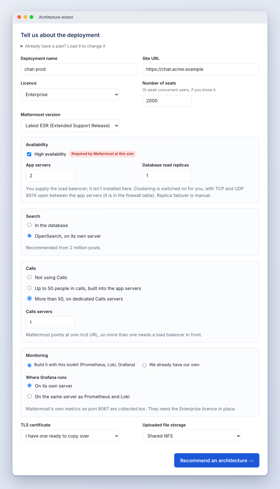

A lab asks the same questions, because they are the same questions. What changes is where a yes
puts things: "OpenSearch, on its own server" becomes "OpenSearch, on this box too", and the
answers that only exist to spread work over several servers — seats, high availability, how many
Calls servers — stop being asked, because there is nowhere to spread it to. You can end up with
every role on the box, which is the `all-in-one` profile, or any part of it. The plan says so one
profile at a time, so a lab that doesn't want OpenSearch simply leaves it out:

```yaml
deployment: lab
nodes:
  - name: lab01
    address: 10.10.1.50
    profiles: [core, calls, monitoring]
```

A lab box isn't sized from a seat band, because no published tier describes a server running
everything at once. It is sized by what each part needs to start, added up — the same floors in
[catalogue.yml](inventory/group_vars/all/catalogue.yml) that `install.sh --preflight` holds the
server to. The design decisions on the last step then list every warning the installer is going to
give you about components sharing a box, from the same rules it uses, so you hear it before you
build the thing rather than after.

High availability is a checkbox, offered only on Enterprise, because clustering, Enterprise search
and dedicated Calls servers are all Enterprise features. The badge beside it shows whether Mattermost
marks high availability as required at your size (it does from 2,000 users up). The choice is still
yours.

Turning it on asks for the number of app servers and read replicas, and stops offering local disk
for uploads, since several app servers can't share one server's disk. The plan then clusters the app
servers for you. Each one gets the others in `mattermost_cluster_peers`, so Mattermost's cluster mode
is switched on and TCP and UDP 8074 is opened between them. The firewall table lists those flows. You
still need the Enterprise licence on every app server and a load balancer in front. See
[Example: two app servers](#example-two-app-servers).

### 2. The recommendation

The servers it suggests, a diagram of how they connect and the order to install them in. Add or
remove servers here and the diagram, order and firewall rules follow.

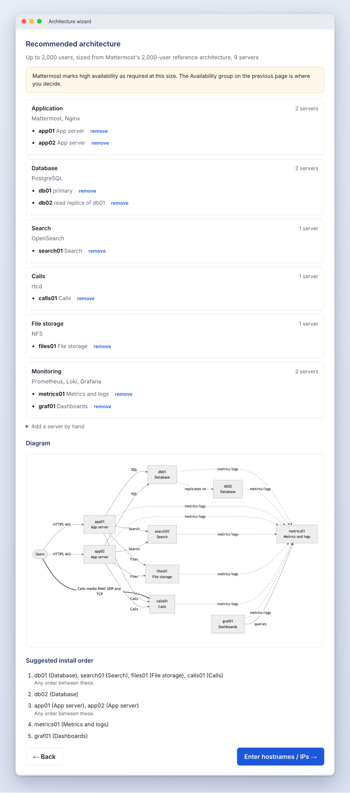

### 3. Names and addresses

Each server needs the address the others will reach it on. A hostname works if every server can
resolve it. The name is a label for the plan and the dashboards. On install, a server finds itself
by that name matching its hostname, or by one of its own addresses. Pass `--estate-node NAME` if it
can't.

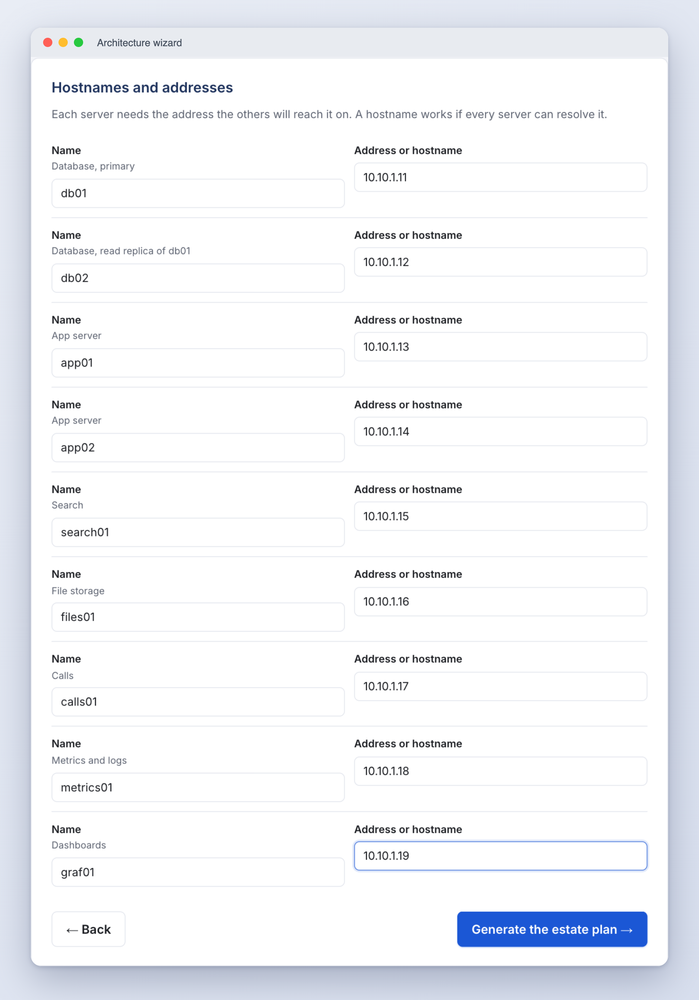

### 4. The plan

The encoded plan, the install order, and the tables to hand on. Paste the plan when `install.sh`
asks for it, or save it and pass it in. To change a plan later, paste it back into step 1 and carry
on from the recommendation.

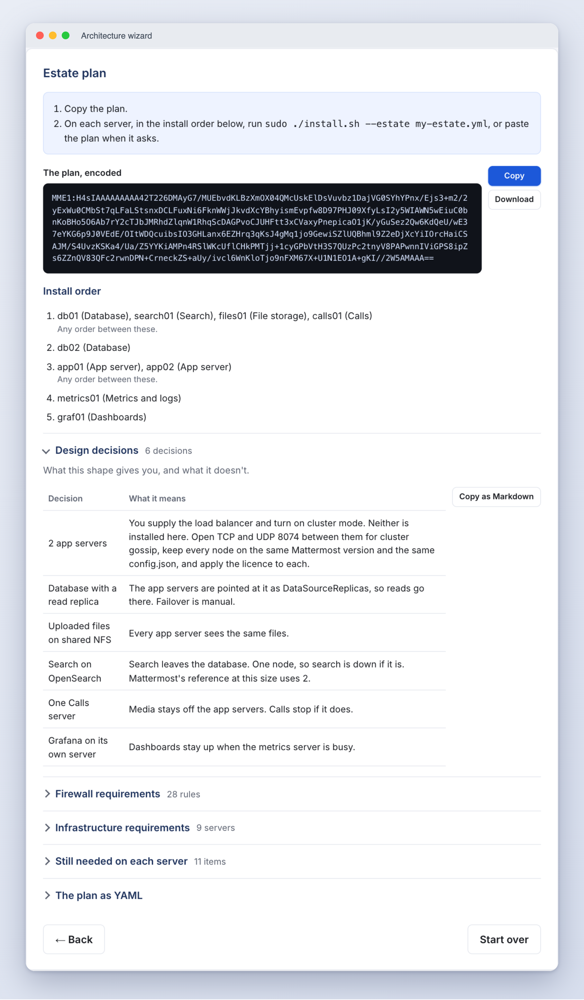

The firewall table lists every flow the estate needs, with source, destination, port and what it
carries. Flows between your own network segments are yours to open. The installer only opens ports
on the servers themselves.

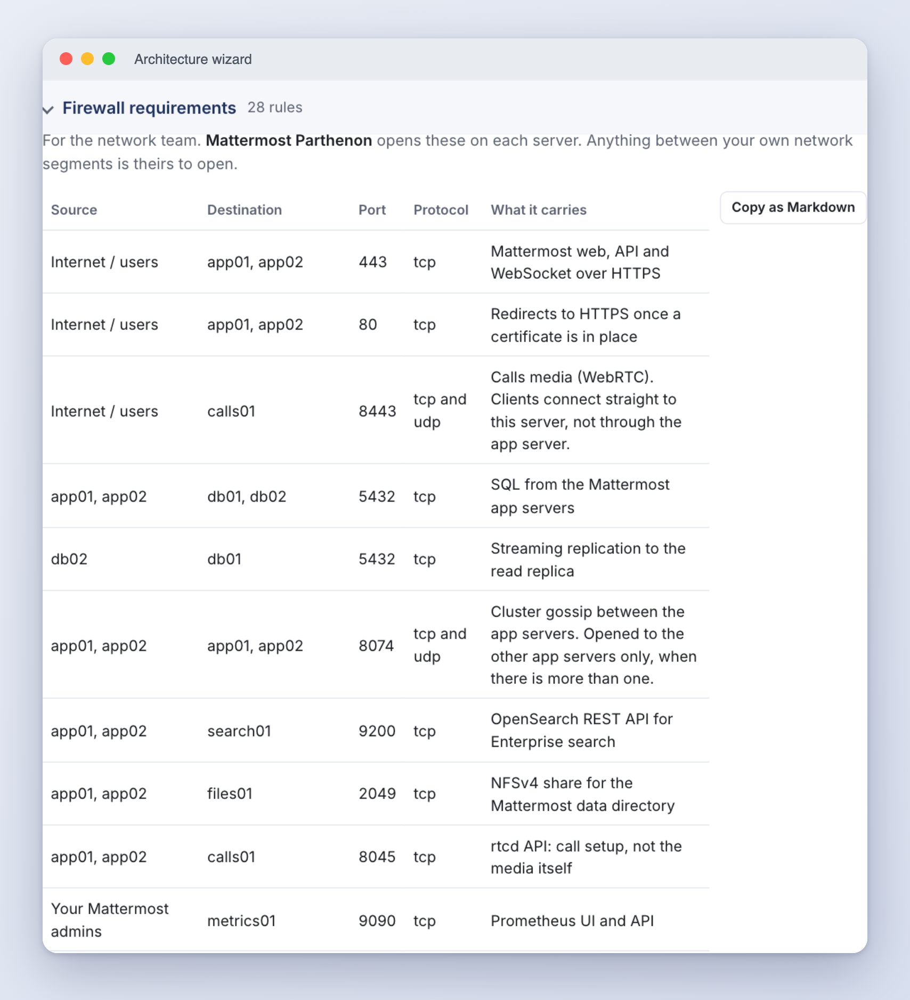

### Where the sizes come from

Sizing follows Mattermost's own [reference
architectures](https://docs.mattermost.com/deployment-guide/scale/scaling-for-enterprise), one band
per published tier: 200, 2,000, 15,000, 30,000 and 50,000. vCPU and memory are Mattermost's
figures for that tier. Two things differ because this toolkit builds different servers. Mattermost
gives the proxy a server of its own where Nginx runs on the app servers here, and Mattermost's
search tier is a cluster where this toolkit installs a single node. Disk is this toolkit's
estimate, because Mattermost publishes a growth formula rather than figures.

Mattermost states those tiers in **concurrent users**, which is well below the number of accounts.
The wizard asks for seats, so a seat count lands you in a band at or above the one your real
concurrency needs. Enter peak concurrent users to match Mattermost's figures like for like.

## Installing an estate

Every server runs the same command with the same plan. Each works out which node it is, from its
hostname or one of its addresses, and derives its own answers: profiles, `mattermost_db_host`, the
`*_allowed_clients` lists, `monitoring_estate`, scrape sources and the Loki URL. That replaces the
hand-copying in the [split-estate example](#example-a-split-estate). The result goes
to `/etc/mattermost-parthenon/answers.yml`, the file an interactive run writes, and behaves like
`--answers` from there. Nothing is asked, so a setting the server needs and the plan can't know
stops the plan with a message naming it.

[estate.example.yml](estate.example.yml) documents the plan format if you would rather write one by
hand.

### 1. Preflight

```bash
./install.sh --estate my-estate.yml --preflight
```

Preflight resolves every other server in the plan, tries the ports this one has to reach, and
compares memory and CPU with what its role needs. It changes nothing.

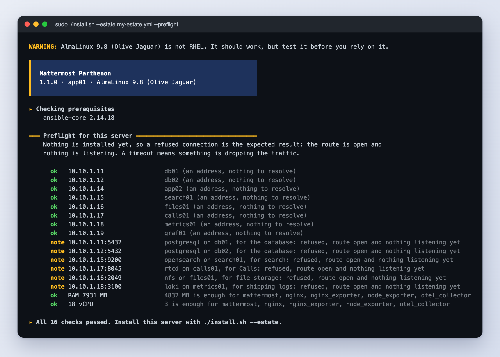

Nothing is listening yet, so a refused connection is expected: the route and the firewall are open
and the service isn't there. A timeout is the one to take to the network team.

### 2. One set of passwords

By default each server generates its own passwords, and you copy the database one from the database
server to the app servers. Generate them once instead:

```bash
python3 tools/estate_plan.py new-secrets --out estate-secrets.yml
```

That writes one `ansible-vault` encrypted file holding the database, replication, OpenSearch and
Grafana passwords. Carry it to each server and pass it with the plan:

```bash
./install.sh --estate my-estate.yml --estate-secrets estate-secrets.yml
```

Each server takes only the entries its role needs. The database server gets the database password,
the app servers get the database and OpenSearch ones, and Grafana's goes to the monitoring server.
Nothing else in the file is written to that server, and the checklist drops the lines telling you to
copy them by hand.

### 3. Install

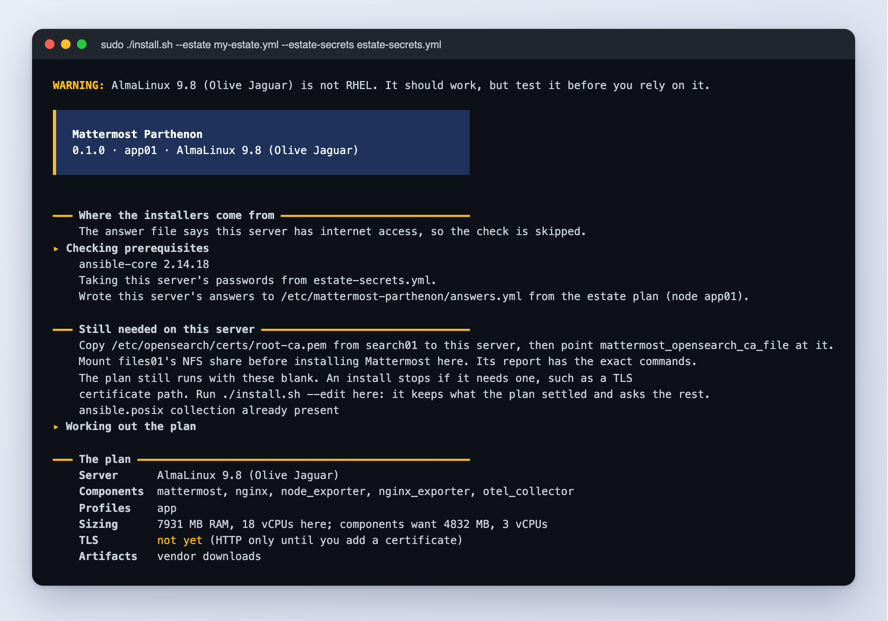

Four things are left out of the plan on purpose, because a plan is made in a browser and passed
around: passwords, the licence, the TLS certificate and key, and the OpenSearch CA. The install
prints them as a checklist. Run `./install.sh --edit` on the same server to fill them in. It keeps
everything the plan settled and asks about the rest.

## What it can install

Each component is an Ansible role. Exporters are added automatically next to whatever they
watch, so you don't pick them yourself.

| Component | Role | What it's for |
|---|---|---|
| Mattermost (Enterprise or Team) | `mattermost` | The application server |
| PostgreSQL | `postgresql` | Mattermost's database |
| Nginx | `nginx` | Reverse proxy and TLS termination |
| Calls media server | `rtcd` | Audio, video and screen share for Mattermost Calls |
| Calls job service | `calls_offloader` | Call recording, transcription and live captions. Runs each job as a container, so this is the one server that gets Docker |
| OpenSearch | `opensearch` | Enterprise search, with the analysis-icu plugin |
| Prometheus | `prometheus` | Collects metrics from every server |
| Grafana | `grafana` | Dashboards and alerting |
| Loki | `loki` | Stores the logs every server ships |
| node_exporter | `node_exporter` | Host metrics, on every server that's monitored |
| postgres_exporter | `postgres_exporter` | Added next to PostgreSQL |
| nginx-prometheus-exporter | `nginx_exporter` | Added next to Nginx |
| elasticsearch_exporter | `opensearch_exporter` | Added next to OpenSearch |
| blackbox_exporter | `blackbox_exporter` | On the monitoring server, when there's a site URL or a Calls server to check: checks the site, its certificate and the Calls port from outside |
| NFS server | `nfs` | Exports a share for Mattermost's data directory, so app servers share one copy of the uploaded files |
| OpenTelemetry Collector | `otel_collector` | Ships logs to Loki, on every server that has a Loki to send to |

Three more roles do the plumbing. `common` handles OS checks, firewall rules, SELinux, fapolicyd
and working out how the pieces connect. It also hides the differences between RHEL and
Debian or Ubuntu, so the other roles don't have to. `artifacts` finds, downloads and verifies the tarballs,
and `report` writes the architecture document.

Roles are grouped into profiles. Give a server one profile, several, or a custom list:

| Profile | Components | Typical use |
|---|---|---|
| `core` | postgresql, mattermost, nginx | Small teams, one server |
| `app` | mattermost, nginx | Application server in a split estate |
| `database` | postgresql | Dedicated database server, or a read replica of one |
| `calls` | rtcd | Dedicated Calls server, once Calls outgrows the app servers |
| `jobs` | calls_offloader | Call recording, transcription and live captions |
| `search` | opensearch | Dedicated search server |
| `storage` | nfs | NFS share for the Mattermost data directory |
| `monitoring` | prometheus, loki, grafana | Watches the rest of the estate and keeps its logs |
| `metrics` | prometheus, loki | The same, on estates big enough to keep Grafana apart |
| `dashboards` | grafana | Grafana on its own, pointed at a metrics server |
| `all-in-one` | everything | Labs and proofs of concept only |

You can put everything on one box. The installer tells you why that's a bad idea before it starts
(OpenSearch fighting Mattermost for memory, monitoring living on the thing it monitors, and so on),
and the report repeats it under Risks. The wizard's **lab on one server** says the same things on
the way in, from the same rules, so you hear it before you build the box as well as after.

## Ways to install

### Interactively

Run `./install.sh`. It asks for the profile, the site URL, which Mattermost build you want,
where uploaded files go, TLS, and whatever the chosen components need. Passwords left blank are
generated and kept in `/etc/mattermost-parthenon/secrets.yml` (root only).

On any server that isn't the monitoring server it then asks two questions: should Prometheus on
the monitoring server watch this one, and should its logs go to Loki there. A yes installs the
exporters or the log collector, points them at the address you give, and opens only the ports
Prometheus needs, to that address only. Logs go out to Loki, so nothing opens for them here. At the
end it prints the line to add on the monitoring server, whose firewall then lets this server in.
A server running Loki without Prometheus also asks which servers send it logs.

### Running it again

On a server that has been installed before, the installer asks what to do with the saved answers
in `/etc/mattermost-parthenon/answers.yml`:

| Choice | Does |
|---|---|
| Use them as they are | Goes straight to the plan with the same answers |
| Go through them and change what you need | Asks every question again with your last answer as the default |
| Start again with blank answers | Asks every question with no answers filled in |

When you go through them, press Enter to keep an answer, type a new one to change it, or type `-`
to clear it. Passwords left blank stay as they were. The servers on a monitoring server come up
one at a time with their address and components filled in, so you can change one, drop it with
`-`, or add more at the end. Settings no question covers, such as alert thresholds you added by
hand, are copied into the new file. The old file is kept next to it as a `.bak`.

`./install.sh --edit` goes straight to changing the saved answers, and
`./install.sh --edit --answers FILE` starts from that file instead. Either way the result is saved
to `/etc/mattermost-parthenon/answers.yml`.

### From an answer file

Copy [answers.example.yml](answers.example.yml), which documents every setting, and run:

```bash
./install.sh --answers /root/chat-prod.yml
```

Nothing is asked that the answer file already settles. Add `--non-interactive --yes` for fully
unattended runs.

The plan stops if the answer file has a setting it doesn't know (usually a typo) or a value of the
wrong kind, such as `10.0.0.5` where a list like `[10.0.0.5]` is needed. `--verify-only` and
`--report-only` only warn, so an older answer file doesn't block them.

### From an estate plan

Plan the estate in the [architecture wizard](#the-architecture-wizard), then
`./install.sh --estate my-estate.yml` on each server. See [Installing an estate](#installing-an-estate).

### From flags

`./install.sh --help` lists everything:

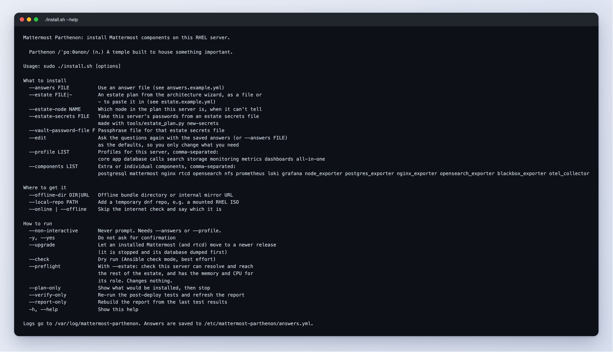

```bash
./install.sh --profile core --non-interactive --yes
./install.sh --profile app,calls --answers /root/app01.yml
./install.sh --components postgresql,node_exporter --answers /root/db01.yml
```

The other flags:

| Flag | Does |
|---|---|
| `--edit` | Asks the questions again with the saved answers (or `--answers FILE`) as the defaults |
| `--estate FILE\|-` | Uses an estate plan from the architecture wizard (see [estate.example.yml](estate.example.yml)); `-` reads it from stdin |
| `--estate-node NAME` | Skips matching and says which node in the plan this server is |
| `--estate-secrets FILE` | Takes this server's passwords from a vault-encrypted estate secrets file |
| `--vault-password-file F` | Passphrase file for that estate secrets file |
| `--preflight` | With `--estate`: checks this server can reach the rest of the estate and has the memory and CPU for its role |
| `--plan-only` | Shows what would happen, then stops |
| `--upgrade` | Lets an installed Mattermost (and rtcd) move to the newest release on its channel |
| `--check` | Dry run |
| `--verify-only` | Re-runs the post-deploy tests and refreshes the report |
| `--report-only` | Rebuilds the report from the last results |
| `--uninstall` | Removes components from this server (all of them, or those named by `--profile` or `--components`) |
| `--purge` | With `--uninstall`: deletes the data, service users and, once nothing is left, the secrets and saved answers |
| `--offline-dir DIR\|URL` | Uses a local copy of the installers |
| `--local-repo PATH` | RHEL only: adds a mounted RHEL ISO as a temporary dnf repo |
| `--online`, `--offline` | Skips the connectivity question |

### Example: one server for a small team

```yaml
deploy_name: acme-chat
deploy_profiles: [core]
mattermost_site_url: https://chat.acme.example
mattermost_version_channel: latest-esr
tls_mode: provided
tls_cert_file: /root/certs/chat.acme.example.crt
tls_key_file: /root/certs/chat.acme.example.key
```

### Example: two app servers

Both app servers point at the same database and sit behind a load balancer. Each lists the other:

```yaml
# app01 (10.10.1.12)
deploy_profiles: [app]
deploy_name: chat-prod
mattermost_site_url: https://chat.example.com
mattermost_license_file: /root/mattermost.mattermost-license
mattermost_db_host: 10.10.1.11
mattermost_db_password: "<db_password from db01's secrets.yml>"
mattermost_proxy_sources: [10.10.1.5]      # the load balancer
mattermost_cluster_peers: [10.10.1.13]     # app02
mattermost_file_driver: amazons3           # shared storage; local disk won't do
```

app02 is the same with `mattermost_cluster_peers: [10.10.1.12]`. That writes `ClusterSettings`
(`Enable`, `ClusterName` from `deploy_name`, `GossipPort`) and opens 8074 on TCP and UDP to the peer
only. Mattermost finds its peers through the database. Give both the same `deploy_name`, version and
licence, and add each app server to `postgresql_allowed_clients` on the database server. Verify warns
until the other node is installed.

### Example: a split estate

Five servers, each with its own answer file. The pieces find each other through the `*_host`,
`*_url`, `*_sources` and `*_allowed_clients` settings.

```yaml
# db01 (10.10.1.11)
deploy_profiles: [database]
postgresql_allowed_clients: [10.10.1.12]
deploy_monitoring_exporters: true
monitoring_scrape_sources: [10.10.1.15]
logging_loki_url: http://10.10.1.15:3100
```

```yaml
# app01 (10.10.1.12)
deploy_profiles: [app]
mattermost_site_url: https://chat.acme.example
mattermost_db_host: 10.10.1.11
mattermost_db_password: "<copied from secrets.yml on db01>"
mattermost_rtcd_url: http://10.10.1.13:8045
mattermost_opensearch_url: https://10.10.1.14:9200
mattermost_opensearch_password: "<copied from secrets.yml on search01>"
mattermost_opensearch_ca_file: /root/search-ca.pem
tls_mode: provided
tls_source_dir: /root/certs
deploy_monitoring_exporters: true
monitoring_scrape_sources: [10.10.1.15]
logging_loki_url: http://10.10.1.15:3100
```

```yaml
# calls01 (10.10.1.13)
deploy_profiles: [calls]
rtcd_api_sources: [10.10.1.12]
rtcd_ice_host_override: 203.0.113.20     # the address clients use
deploy_monitoring_exporters: true
monitoring_scrape_sources: [10.10.1.15]
logging_loki_url: http://10.10.1.15:3100
```

```yaml
# search01 (10.10.1.14)
deploy_profiles: [search]
opensearch_allowed_clients: [10.10.1.12]
deploy_monitoring_exporters: true
monitoring_scrape_sources: [10.10.1.15]
logging_loki_url: http://10.10.1.15:3100
```

```yaml
# mon01 (10.10.1.15)
deploy_profiles: [monitoring]
monitoring_site_url: https://chat.acme.example
monitoring_estate:
  - {name: db01, address: 10.10.1.11, components: [postgresql]}
  - {name: app01, address: 10.10.1.12, components: [mattermost, nginx]}
  - {name: calls01, address: 10.10.1.13, components: [rtcd]}
  - {name: search01, address: 10.10.1.14, components: [opensearch]}
```

Install the database, Calls and search servers first, in any order, then the app server, then
monitoring. The app server needs the database password from db01's secrets file, and the search CA
(`/etc/opensearch/certs/root-ca.pem`) copied over from search01.

To run Grafana on a server of its own, give it the same `monitoring_site_url` and
`monitoring_estate` as the Prometheus server, with the Prometheus server added as
`components: [prometheus]`, and point `grafana_prometheus_url` at it. Grafana builds its alerts and
dashboards from that list, and the instance labels come from the names, so they have to match.

Files the answer file points at have to be on the server before you start: the licence, the search
CA, the TLS certificate and key (or `tls_source_dir`) and `monitoring_site_ca_file`. The plan checks
each one is there and stops, naming the setting, if it isn't, so a wrong path never leaves a server
half installed. The interactive installer asks again when a path it's given doesn't exist.

Anything only local components use stays on 127.0.0.1 with no firewall opening. Anything another
server needs is opened to the addresses you list, and nothing else. Validation stops when a list
is empty but another server has to get in: `postgresql_allowed_clients`, `opensearch_allowed_clients`
and `rtcd_api_sources` without Mattermost on the server, and `monitoring_scrape_sources` for
exporters without Prometheus. Entries may be CIDRs, and `0.0.0.0/0` allows any address.

On the monitoring server, `monitoring_estate` drives the firewall too. Each server's `components`
can include `prometheus`, `loki` and `grafana` as well as the Mattermost pieces, and the
interactive installer asks for them. A server listed with `grafana` or `prometheus` is let in to
this Prometheus (9090), every server listed may reach Loki (3100), and a server listed with
`prometheus` is treated as another scraper, so the exporters and metrics ports here open to it as
if it were in `monitoring_scrape_sources`. On the other servers, Prometheus, Loki and Grafana open
to `monitoring_scrape_sources` so the monitoring server can scrape them. Servers given by name are
looked up when the plan runs; a name that doesn't resolve gets nothing opened, and the plan says so.

The database server sizes `max_connections` for every app server in `postgresql_allowed_clients`:
`mattermost_db_max_open_conns` (100, Mattermost's own default since v11.0) for each, plus 50 spare.
Mattermost's pool is per data source per app server, so each app server may open that many against
the primary and that many again against each read replica, which is why a replica is sized the same
way. `mattermost_db_max_idle_conns` follows at half of it, the 2:1 ratio Mattermost asks for. If you
list a subnet rather than single addresses, set `postgresql_app_servers` to the number of
Mattermost servers behind it. If you change `mattermost_db_max_open_conns`, set it on the
database server too.

### Example: a database with a read replica

A read replica is a read-only copy of the database that follows the primary as it changes.
Mattermost Enterprise sends some of its reads there, which takes load off the primary. It won't
fail over by itself: if the primary is lost, you promote the replica by hand. The report on the
replica has the command.

```yaml
# db01 (10.10.1.11), the primary
deploy_profiles: [database]
postgresql_replication: primary
postgresql_replica_hosts: [10.10.1.21]
postgresql_allowed_clients: [10.10.1.12]
```

```yaml
# db02 (10.10.1.21), the replica
deploy_profiles: [database]
postgresql_replication: replica
postgresql_primary_host: 10.10.1.11
postgresql_allowed_clients: [10.10.1.12]
mattermost_db_password: "<db_password from db01's secrets.yml>"
postgresql_replication_password: "<replication_password from db01's secrets.yml>"
```

```yaml
# and on app01
mattermost_db_replica_hosts: [10.10.1.21]
```

That last line is what makes Mattermost actually read from the replica
(`SqlSettings.DataSourceReplicas`). Without it the replica streams and carries no traffic. An estate
plan derives it for you: name the primary in the replica node's `primary` and every app server gets
pointed at the replica.

Install db01 first. On its first run db02 copies db01 with `pg_basebackup`, then keeps following
it. It stops rather than overwrite a data directory that already holds a database of its own.
Give both servers the same `postgresql_allowed_clients` and `mattermost_db_max_open_conns`. A
replica won't start with a lower `max_connections` than its primary, so the installer raises it
to match if it has to.

Each replica holds a replication slot on the primary, and the primary keeps WAL until the replica
has received it. A replica that stays down would make the primary keep WAL until its disk filled,
so `max_slot_wal_keep_size` caps how much one slot can hold. The default cap is 20% of the
filesystem under the primary's data directory (`postgresql_slot_wal_keep_pct`), or you can give a
size in MB with `postgresql_max_slot_wal_keep_size`. A replica that falls past the cap can't catch
up and has to be rebuilt: stop PostgreSQL on it, move `/var/lib/pgsql/data` aside and run
`install.sh` again. The monitoring server warns long before that point.

A server without replicas needs none of this. With no slots, PostgreSQL recycles WAL at every
checkpoint and keeps around `max_wal_size` of it (1 GB by default).

### Example: shared file storage over NFS

Mattermost keeps uploaded files in `mattermost_data_dir`. With more than one app server they all
have to see the same files, so put them on an NFS share (or S3, see `mattermost_file_driver`).

```yaml
# files01 (10.10.1.16)
deploy_profiles: [storage]
nfs_export_dir: /srv/mattermost/data
nfs_allowed_clients: [10.10.1.12, 10.10.1.22]
```

NFSv4 over TCP only, so port 2049 is the only one opened, and only to the servers you list. Every
client write lands as the share's owner (`all_squash`), so the `mattermost` user on each app server
doesn't need the same uid as on files01. Set `nfs_squash: none` if you would rather keep the
client's own uid, in which case the uids do have to match.

Then mount it on each app server. The report on files01 gives these lines filled in:

```bash
dnf install -y nfs-utils        # RHEL
apt-get install -y nfs-common   # Debian or Ubuntu
mkdir -p /var/opt/mattermost/data
mount -t nfs4 -o rw,hard,timeo=600,retrans=2,noatime,nodiratime,_netdev 10.10.1.16:/srv/mattermost/data /var/opt/mattermost/data
```

```text
# /etc/fstab on each app server
10.10.1.16:/srv/mattermost/data  /var/opt/mattermost/data  nfs4  rw,hard,timeo=600,retrans=2,noatime,nodiratime,_netdev  0 0
```

Mount it before installing Mattermost, or stop Mattermost, move the existing files onto the share
and mount it over the top. `hard` means a write waits for the NFS server to come back rather than
failing, which is what you want for a file store. The monitoring server alerts on the share (RPC
errors and stale handles on files01, and latency, timeouts and retransmissions as each app server
sees them) once files01 is in `monitoring_estate` with `nfs` among its components.

### Example: Calls

Calls runs two ways. Up to about 50 people in calls, it runs inside the app servers and needs no
server of its own. Past that, Mattermost expects a dedicated media server (rtcd), so calls stop
competing with messaging for the app server's CPU.

What you get depends on the licence. Team Edition is 1-to-1 calls and screen sharing, capped at 40
minutes. Professional adds group calls and screen sharing with no time limit. Enterprise adds
recording, transcription, live captions, and rtcd.

Inside the app servers, which is the default:

```yaml
# app01, nothing to add: mattermost_calls_integrated is already true
```

On servers of their own:

```yaml
# calls01 (10.10.1.13)
deploy_profiles: [calls]
rtcd_api_sources: [10.10.1.12]
rtcd_ice_host_override: 203.0.113.20     # the address clients use

# and on app01
mattermost_rtcd_url: http://10.10.1.13:8045
```

Either way the media port works the same, and it is where most Calls problems come from:

- Clients reach UDP **and** TCP 8443 on whichever server runs the media, directly. Nginx must not
  proxy it.
- Behind NAT or a load balancer, that port has to map through unchanged, and
  `rtcd_ice_host_override` has to name the address clients actually use. Get this wrong and calls
  connect but carry no audio, which is exactly what the `calls-port-unreachable` alert watches for.
- If clients can't reach 8443 at all, Calls needs a TURN server. This toolkit doesn't install one.
- With no `rtcd_ice_host_override`, rtcd asks `stun.global.calls.mattermost.com` on UDP 3478 what
  its public address is. Set the override and that lookup stops being needed, which is what you
  want on a network that doesn't let servers out.

rtcd ships with self-registration off. This toolkit turns it on, which is what lets Mattermost
register itself on first contact, and Mattermost's guidance allows that on a private network with
access control. `rtcd_api_sources` is that control: port 8045 stays on loopback until you fill it
in, and then opens to those addresses alone. Set `rtcd_allow_self_registration: false` if the API
port has to be reachable more widely, and register Mattermost through rtcd's admin API instead.

More than one rtcd server needs a load balancer in front of them, with `mattermost_rtcd_url`
pointing at it. Mattermost talks to one URL, so without it only the first server is used. Add a
second once the first passes 70% CPU.

### Example: recording, transcription and live captions

These three are Enterprise features, and none of them runs in rtcd. They are run by a second
service, `calls-offloader`, which starts a container for each job: one to sit in the call and
record it, one to transcribe the recording afterwards, one per call for live captions. Give it a
server of its own:

```yaml
# jobs01 (10.10.1.17)
deploy_profiles: [jobs]
calls_offloader_api_sources: [10.10.1.12]

# and on app01
mattermost_job_service_url: http://10.10.1.17:4545
```

That is the whole configuration. Recording and transcription are switched on in `config.json` for
you, so they work when the run finishes rather than after a trip through the System Console.
`mattermost_calls_transcriptions` and `mattermost_calls_live_captions` turn the other two on and
off; captions are the one that is off by default, because it is the only one that has to keep up
with the call in real time and it holds a transcriber for the whole of it.

Four things about this one are worth knowing before you build it.

**It needs Docker, and nothing else here does.** The install puts it there: `docker.io` from the
distribution's own archive on Debian and Ubuntu, and `docker-ce` from Docker's repository on RHEL,
which has no Docker in AppStream. That repository is the only third-party one this toolkit ever
adds, and it is only added on a job server. `docker-ce` replaces Podman and runc, so the install
stops and says so rather than taking them off a server something else is using. Set
`calls_offloader_manage_docker: false` if you manage Docker yourself.

**The service account is root on that host.** It has to be in the `docker` group to start
containers, and anyone in that group can start a privileged one. That, more than the CPU, is why
the job service belongs on its own server, and why `calls_offloader_api_sources` matters: port
4545 stays on loopback until you fill it in, and then opens to the app servers alone.

**A recording is uploaded as an ordinary attachment.** An hour at medium quality is about 700 MB,
and at high quality about 1.2 GB, against Mattermost's 100 MiB default. So with recording on, the
install raises `FileSettings.MaxFileSize` and Nginx's `client_max_body_size` to fit a full-length
recording at the quality and duration you chose. That raises them for every upload, not just
recordings. Getting this wrong is the usual reason a recording runs to the end and then never
appears in the channel.

**The job images come from Docker Hub.** Everything else here is fetched and checksummed before
anything is installed; these two are pulled by the service the first time someone records a call.
On a server with no route out, put them in the bundle:

```bash
tools/build-offline-bundle.sh --components calls_offloader --with-job-images
```

Their tags follow the Calls plugin rather than `calls-offloader` — the plugin has them built in —
so check `calls_offloader_recorder_image` and `calls_offloader_transcriber_image` after a
Mattermost upgrade. The post-deploy test warns when an image the job service will ask for is not
on the server.

Sizing: Mattermost starts at 8 vCPU and 16 GB, which carries eight low-quality recordings at once,
six at medium or four at high, at around 70% CPU. Transcription is slower again: an hour of audio
takes about seven minutes on four threads with the `base` model, and about twenty-three with
`small`. The install sizes `max_concurrent_jobs` from the host's CPUs and the quality you picked.

Like rtcd, Mattermost talks to one job service URL, so more than one job server needs a load
balancer in front with `mattermost_job_service_url` pointing at it.

### Example: no internet access

On a machine that does have internet access:

```bash
tools/build-offline-bundle.sh --arch amd64 --edition enterprise --channel both --with-rpms
```

Carry `mm-bundle-<date>.tar.gz` across, unpack it and run:

```bash
./install.sh --offline-dir /srv/mm-bundle-20261029
```

`--channel both` puts the latest stable and the latest ESR in the bundle, so you can still choose
on the day. [docs/offline.md](docs/offline.md) covers the bundle layout, hand-filled folders and
internal mirrors.

## Taking components off a server

`./install.sh --uninstall` reverses an install. By default it removes everything the last
install put on this server. Name what to remove with `--profile` or `--components` to take off
only some of it, for example a Loki you no longer want:

```bash
sudo ./install.sh --uninstall --components loki,grafana
```

It shows what goes and what stays, and asks before it starts. For each component it stops and
disables the service, closes the firewall ports the install opened, deletes the install
directory, the `/opt/<name>` link, the systemd unit and the config the toolkit wrote, and
stops fapolicyd trusting the paths. PostgreSQL and Nginx are removed with the package manager
(`dnf` or `apt`, never a purge), and their module streams are reset on RHEL 9.

The data stays: the PostgreSQL cluster, Mattermost's `config.json`, uploaded files and plugins,
OpenSearch indices, metrics, logs, the secrets file and the saved answers. That means you can
put a component back with a normal run and find it as you left it. To delete all of that as
well, add `--purge`. It also removes the service users, and once nothing is left, the secrets,
the saved answers, the state and the download cache. Interactively you have to type the
server's name to go ahead. With `--non-interactive` you have to pass `--yes`.

When some components stay, the saved answers are rewritten to list only those, so the next run
does not put the removed ones back. The old file is kept as a `.bak`. A Mattermost server that
uses this one's PostgreSQL, a Prometheus that scrapes it or a Grafana that reads from it still
points here. Change those servers' answers yourself and re-run them.

Two things are not undone, because they may have been set before the toolkit arrived: the
SELinux booleans `httpd_can_network_connect` and `nfs_export_all_rw`, and the baseline packages
(firewalld, chrony and the rest). `nfs-utils` (`nfs-common` on Debian and Ubuntu) also stays on
RHEL, since it is the NFS client too.

## Where installers come from

Before downloading anything, the installer lists the sites it needs and asks whether it may check
them. It checks them all at once (through `https_proxy` if you've set one) and shows the result.

| Site | What we get there |
|---|---|
| releases.mattermost.com | Mattermost server tarballs and their GPG signatures |
| docs.mattermost.com | The version archive: which release is the latest stable and which is the latest ESR, with their SHA-256 checksums |
| github.com | rtcd, calls-offloader, Prometheus and the exporters, plus their published checksum files |
| release-assets.githubusercontent.com | Where GitHub actually serves those downloads from |
| api.github.com | Looking up "latest" versions (rtcd and calls-offloader by default). Pinned versions don't use it. |
| artifacts.opensearch.org | OpenSearch, its ICU plugin, their signatures and SHA-512 checksums |
| dl.grafana.com | The Grafana tarball |
| grafana.com | Grafana's download API, for the checksum |
| galaxy.ansible.com | The `ansible.posix` collection Ansible needs |

PostgreSQL and Nginx come from your own package repositories: the RHEL CDN, Satellite, a mirror or
a mounted ISO with dnf, or the Debian or Ubuntu archive or a mirror of it with apt. They get the
distribution's security updates like everything else on the box.

A Calls job server needs two more, and neither is in the list above, because neither is needed
when the list is checked. On RHEL, `download.docker.com` supplies Docker Engine during the
install; Debian and Ubuntu take `docker.io` from their own archive like any other package. Then
`registry-1.docker.io` and `auth.docker.io` serve the recorder and transcriber images, which the
job service pulls the first time someone records a call, not during the install. Both are covered
by the offline bundle — see [the Calls job images](docs/offline.md#the-calls-job-images).

If you say no to the check, or any site fails, it asks for a folder or mirror instead, shows what
it found there and asks you to confirm. If only some sites fail you can choose to carry on
online, for example when the failed ones serve components this server doesn't run.

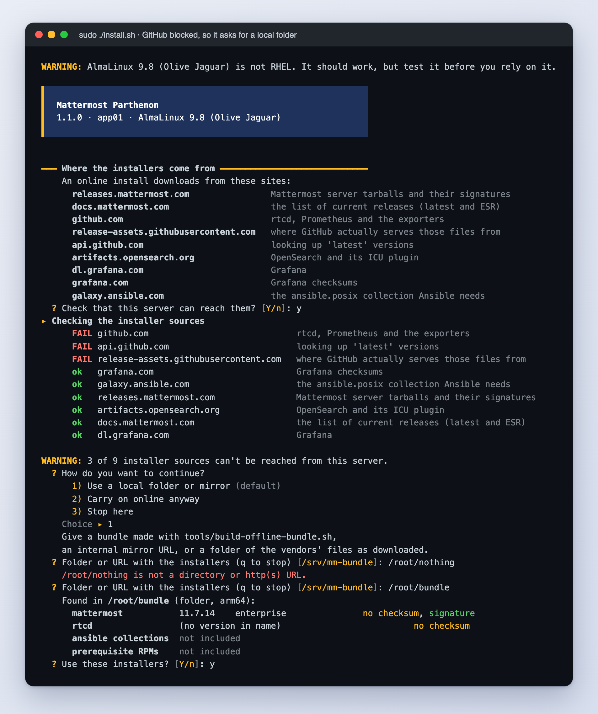

An answer file settles all this without questions:

| `deploy_internet` | What happens |
|---|---|
| `auto` | Checks the sites and downloads. If `artifact_source` is set, uses that instead. |
| `yes` | Doesn't check, just downloads. |
| `no` | Uses `artifact_source`. Asks for it interactively if it's empty; an unattended run stops. |
| left out | Asks permission first, as above. |

### How downloads are checked

Every tarball is checked before it's unpacked. If a check fails the install stops, and the file
stays in `/var/cache/mattermost-parthenon` for you to look at.

| Download | Checked against |
|---|---|
| Mattermost | GPG signature with Mattermost's key (`A1B31D46F0F3A10B02CF2D44F8F2C31744774B28`), plus the SHA-256 from the version archive |
| OpenSearch and its ICU plugin | GPG signature with OpenSearch's key (`C5B7498965EFD1C2924BA9D539D319879310D3FC`), plus the vendor's SHA-512 |
| Everything else | The vendor's published SHA-256 |

The keys are held in this repo. We never trust a key that came from the download source.

## Versions we deploy

Mattermost, rtcd and calls-offloader follow the latest release by default when they're first
installed. After that,
re-runs keep the installed version until you pass `--upgrade`. Everything else is pinned in
[inventory/group_vars/all/defaults.yml](inventory/group_vars/all/defaults.yml), so an install
today and an install next month get the same thing. Change any of them in the answer file; most
accept `latest`.

| Component | Setting | Default | What that was on 29 October 2026 |
|---|---|---|---|
| Mattermost | `mattermost_version_channel` | `latest-stable` (the installer suggests `latest-esr`) | 12.0.1 stable, 11.7.14 ESR |
| rtcd | `rtcd_version` | `latest` | 1.2.6 |
| calls-offloader | `calls_offloader_version` | `latest`, newest plain X.Y.Z tag (upstream publishes `-dev` builds as releases too) | 0.9.6 |
| Calls recorder and transcriber images | `calls_offloader_recorder_image`, `calls_offloader_transcriber_image` | pinned | v0.8.8 and v0.7.1, following the Calls plugin |
| PostgreSQL | `postgresql_version` | `16` from AppStream on RHEL; the release's own version on Debian and Ubuntu (Debian 12: 15, Debian 13: 17, Ubuntu 24.04: 16) | 16.15 on RHEL 9.8 |
| Nginx | `nginx_module_stream` | RHEL's default stream; the release's own package on Debian and Ubuntu | 1.20.1 on RHEL 9.8 |
| OpenSearch | `opensearch_version` | `2.19.7` | pinned |
| Prometheus | `prometheus_version` | `3.15.1` | pinned |
| node_exporter | `node_exporter_version` | `1.12.1` | pinned |
| postgres_exporter | `postgres_exporter_version` | `0.20.1` | pinned |
| nginx-prometheus-exporter | `nginx_exporter_version` | `1.5.3` | pinned |
| elasticsearch_exporter | `opensearch_exporter_version` | `1.11.0` | pinned |
| blackbox_exporter | `blackbox_exporter_version` | `0.29.1` | pinned |
| Grafana OSS | `grafana_version` | `13.3.0` | pinned |
| Loki | `loki_version` | `3.7.9` | pinned |
| OpenTelemetry Collector (contrib) | `otel_collector_version` | `0.165.0` | pinned |
| ansible.posix | `requirements.yml` | `>=1.5.4,<2.0.0` | 1.6.2 |

Mattermost's ESR line is the safer choice for most customers. Stable gets new features every
month and has a shorter support window. Pin an exact build with
`mattermost_version_channel: pinned` and `mattermost_version: 11.7.14`.

On arm64 servers, Mattermost's tarballs ship without the prepackaged plugins, so Calls, Jira,
GitHub and the rest have to come from the Marketplace. The report flags this.

## What happens on each server

### Layout and upgrades

Tarball components unpack into `/opt/<name>-<version>`, with a symlink at `/opt/<name>` pointing
at the live one. Config lives in `/etc` and data in `/var`, outside the install directory.
Upgrading means changing the version and re-running: the new version unpacks next to the old one,
the symlink moves and the service restarts. Rolling back means pointing the symlink back.

Mattermost is handled more carefully, because its database migrations only go forwards:

- Once it's installed, re-runs stay on the installed version even when `latest-stable` or
  `latest-esr` has moved on. The plan says so. Pass `--upgrade` (or set
  `mattermost_allow_upgrade: true`) to move to the newest release. Changing a pinned
  `mattermost_version` is an upgrade by itself. rtcd on `latest` is held the same way.
- Before an upgrade, Mattermost is stopped and its database dumped with `pg_dump -Fc` to
  `/var/lib/mattermost-parthenon/backups`, next to a copy of `config.json`. On an app server with a
  remote database this installs the PostgreSQL client from the `postgresql_version` stream (the
  `postgresql-client-<version>` package on Debian and Ubuntu), which must be the database server's
  major version or newer. If the dump fails, Mattermost restarts on
  the old version and the run stops. Uploaded files aren't copied, so back those up yourself.
  `mattermost_upgrade_backup: false` skips the dump if you've just taken your own backup.
- An older version than the one installed is refused. Going back means restoring the dump, then
  pointing the symlink back by hand.

Mattermost reads `/etc/mattermost/config.json`. We only set the keys we own (site URL, database,
file storage, paths, metrics, search and Calls), so everything else stays editable in the System
Console.

### Security defaults

SELinux stays enforcing and firewalld stays on. Where fapolicyd runs, our install directories get
trust entries so it can stay on too. Debian and Ubuntu have no SELinux or fapolicyd, so the
toolkit leaves AppArmor as it found it and uses firewalld there too. OpenSearch uses certificates from its own
CA, never the public demo ones. PostgreSQL uses SCRAM-SHA-256, with TLS on a self-signed
certificate once remote clients or replicas are allowed. Replicas log in as a separate
`replicator` user, which pg_hba.conf only lets in for replication. Each replica makes its own
certificate rather than keeping the copy of the primary's key. Generated passwords live in
`/etc/mattermost-parthenon/secrets.yml`, root only.

### Post-deploy tests

Every role carries its own checks. They run at the end of every install, and again whenever you
run `./install.sh --verify-only`. They cover:

- services and ports, and Mattermost's health API,
- database logins, and on replicated databases that the replica is streaming and every slot
  is in use,
- the certificate and websocket upgrades through Nginx,
- Calls and search reachability,
- scrape targets, and the alert rules and dashboards in Grafana.

A failed critical check fails the run, but only after the report has been written, so you always
get a document that says what went wrong. [docs/testing.md](docs/testing.md) lists every check.

### The architecture document

Each run writes `/var/lib/mattermost-parthenon/reports/latest.md`. It has Mermaid diagrams of the
components, traffic and request flow, and the server's spec. It gives every component's version,
checksum, paths and ports, plus the firewall matrix, security notes and backup guidance. It also
records the monitoring estate and alert counts, every test result, risks and design decisions,
and an operations runbook. Test results are also kept as JSON in
`/var/lib/mattermost-parthenon/results/`.

## Monitoring, alerts and dashboards

When a server takes the `monitoring` profile, the installer offers to build monitoring for the
whole estate. It asks for each server's name, address and what it runs (including Prometheus, Loki
or Grafana on other servers), and builds everything below from that list. Only modules that
actually exist get alerts and dashboards. The same list decides which of this server's ports open
to the others; see the firewall notes under the split-estate example.

### What gets collected

| From | How | Port |
|---|---|---|
| Every server | node_exporter, including the state of our systemd services | 9100 |
| Mattermost | its built-in metrics | 8067 |
| PostgreSQL | postgres_exporter, over the local socket | 9187 |
| Nginx | nginx-prometheus-exporter reading stub_status on 127.0.0.1:81 | 9113 |
| OpenSearch | elasticsearch_exporter, over TLS with the search CA | 9114 |
| rtcd | its built-in metrics | 8045 |
| NFS | node_exporter's nfsd collector on the NFS server, and its nfs and mountstats collectors on the servers that mount the share | 9100 |
| Prometheus, Loki and Grafana | their own metrics, on whichever server they run | 9090, 3100, 3000 |
| The site, as users see it | blackbox_exporter fetching `/api/v4/system/ping` and checking the certificate | local |
| Calls media port | blackbox_exporter opening a TCP connection to each rtcd server's media port (UDP and reachability from users' networks aren't tested) | local |

Prometheus scrapes every 30 seconds and keeps 15 days. Every target is labelled with its server's
name, so an alert says "disk 85% full on db01" rather than giving you an IP and a port.

### Logs

Loki runs on the monitoring server. Every server with `logging_loki_url` set (the installer asks)
gets an OpenTelemetry Collector that ships its Mattermost, PostgreSQL, Nginx error and OpenSearch
logs, plus the journal for the services we install. They're labelled with the same server names
as the metrics. Grafana gets a Loki datasource and the Mattermost logs dashboard from the docs.
Loki keeps 14 days. [docs/logging.md](docs/logging.md) covers the settings, what's shipped and why,
security, LogQL examples and troubleshooting.

### Dashboards

There are eight dashboards, generated for the estate, linked to each other and coloured to match
the alert tiers: green, then blue for info, yellow for warning and red for critical. Mattermost's
own community dashboards are provisioned alongside them, in the same *Mattermost* folder.

#### Estate overview

Is the site up, how fast is it, when does the certificate expire, what's down and what's firing.

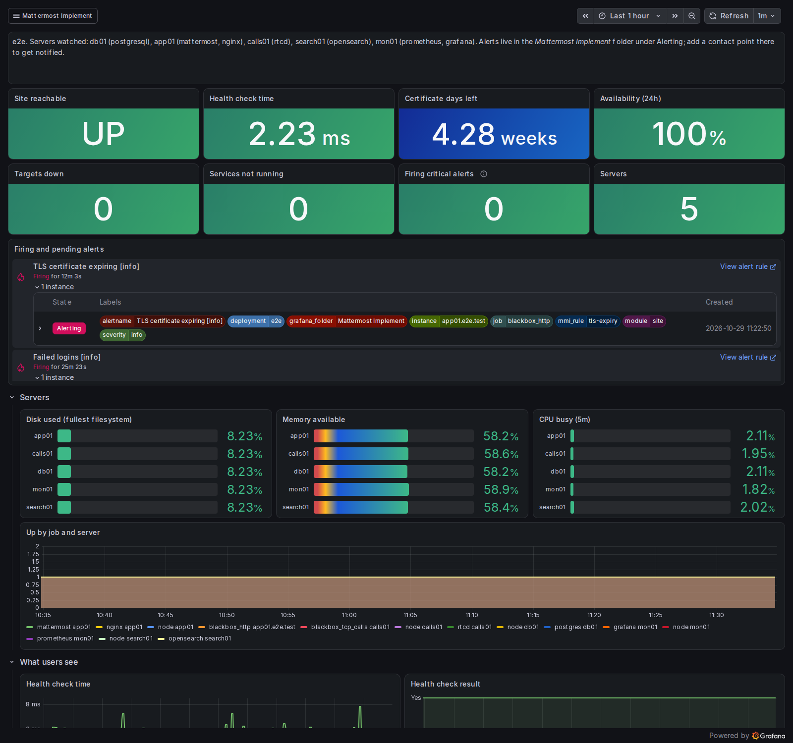

#### Servers

CPU, load, memory, swap, disk usage and a 24-hour forecast, disk I/O, network and UDP errors,
clock offset, file descriptors and service state, for one server or all of them.

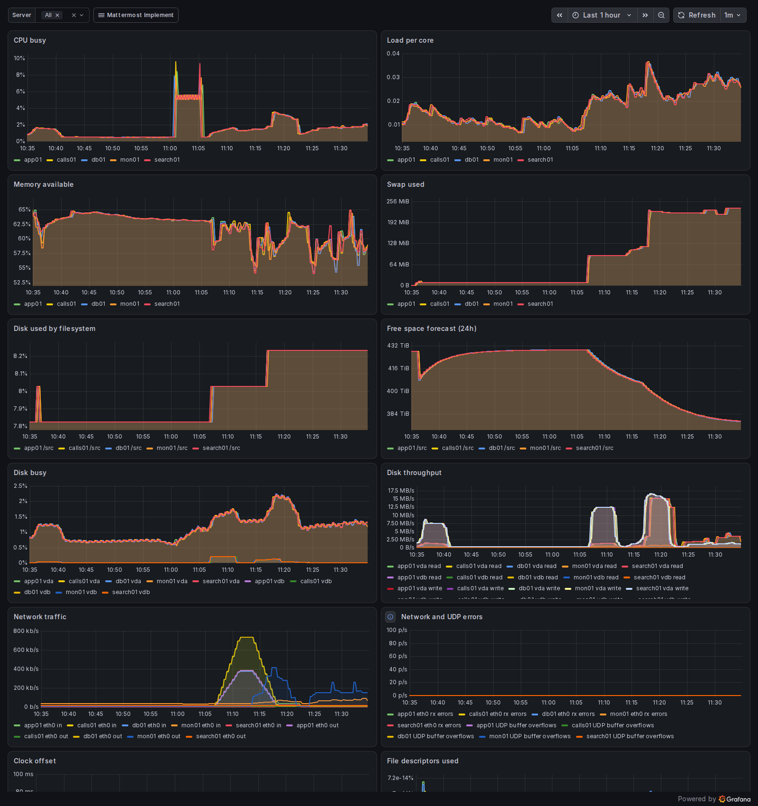

#### Mattermost

API error rate and latency, the slowest handlers, websocket connections, logins and failures,
push notifications, the database pool and the Go heap.

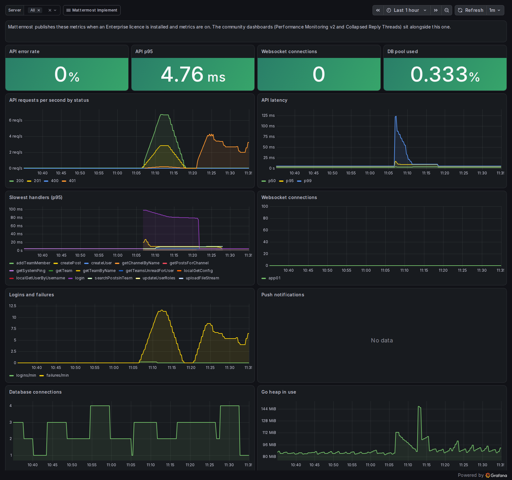

#### PostgreSQL

Connections by state, transactions, the longest open transaction, rows read and written, locks,
deadlocks, cache hit ratio and database size. With a read replica it also shows replication lag
and how much WAL the primary is holding for each replica, against the cap.

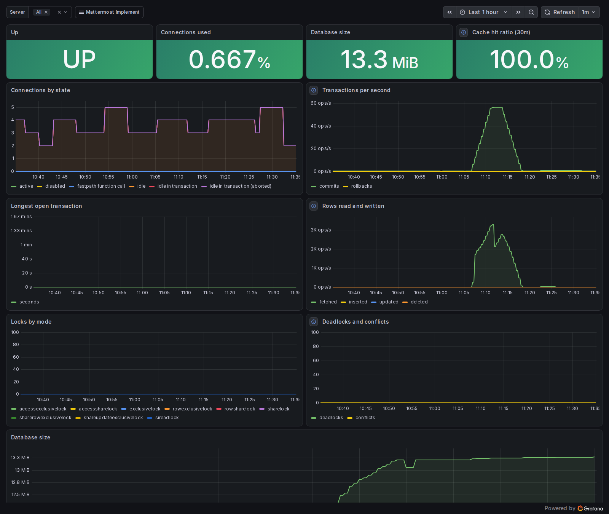

#### OpenSearch

Cluster status, heap, data disk, document count, search and indexing rates, rejected work and
GC time.

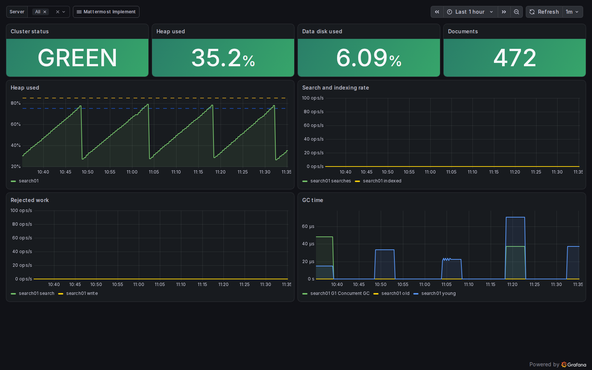

#### Calls

Active sessions, rtcd CPU and memory, file descriptors, UDP buffer overflows, media errors, and
client packet loss and round-trip time, plus the Calls plugin's own RTC sessions, WebSocket events
and RTP tracks from the Mattermost server. The session and client panels fill in once people start
making calls.

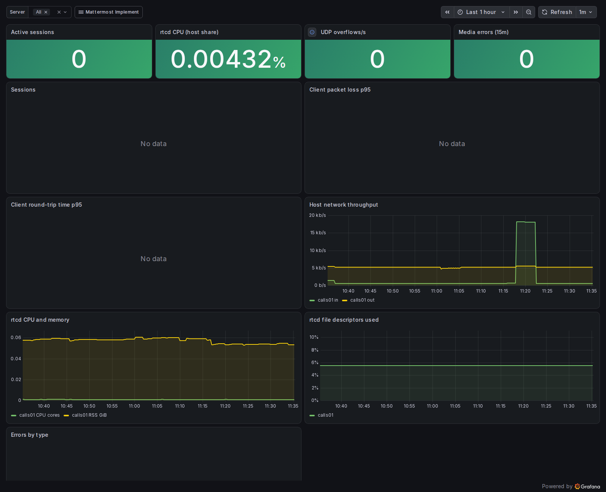

#### Nginx

Connections by state, requests per second and dropped connections.

#### NFS storage

The server side on top (nfsd threads, throughput, calls per second by operation, RPC errors and the
reply cache) and what the app servers mounting the share see underneath (operation latency, timeouts
waiting for the server, retransmissions and throughput per mount).

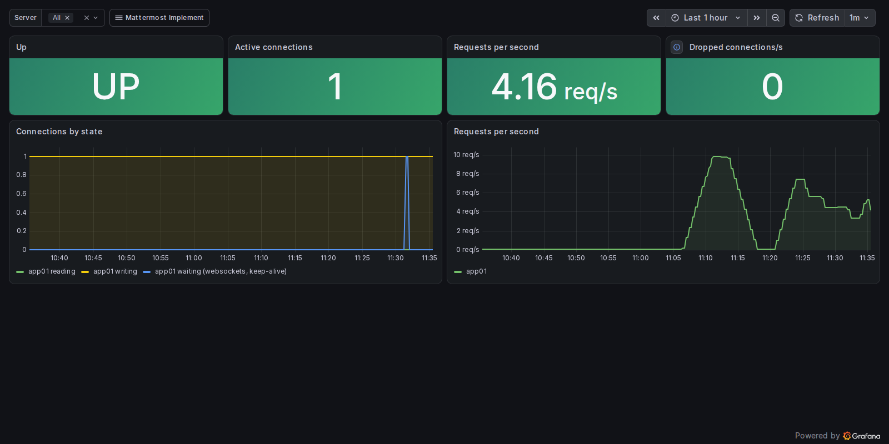

### Alerts

There are 61 metric checks, which become 129 Grafana alert rules for a full estate: 50 critical,
46 warning and 33 info. When the servers ship their logs to Loki, 29 more checks (27 on what the
logs say, 2 on the log pipeline itself) bring a full estate to 167 rules: 66 critical, 64 warning
and 37 info. Each check has up to three tiers and they never overlap. A disk at 85%
fires the warning only, and at 96% the critical only, so one problem raises one alert.

Every rule carries these labels, which is what you route on:

| Label | Values |
|---|---|
| `severity` | `info`, `warning`, `critical` |
| `module` | `host`, `site`, `mattermost`, `postgresql`, `nginx`, `opensearch`, `rtcd`, `nfs`, `monitoring` |
| `mmp_rule` | the check's id, as in the tables below |
| `signal` | `metrics` or `logs` |
| `deployment` | `deploy_name` from the answer file |

Log checks match specific failures rather than counting errors: a Go panic, a PostgreSQL SQLSTATE,
systemd's restart loop, Nginx failing to reach Mattermost. "Errors went up" is judged against the
same time last week, and a new kind of Mattermost error only raises an info alert. They also cover
Mattermost on sites without a licence, where its own metrics are off.
[docs/alerts.md](docs/alerts.md#log-checks) explains how they stay quiet, and
`logging_alert_ignore` takes errors you've accepted.

Each alert's description says what to do when it fires. Rules with no data stay quiet, for example
a module with no traffic yet, or Mattermost metrics without a licence. If a query fails outright,
Grafana raises its own DatasourceError alert, so a dead Prometheus doesn't go unnoticed.

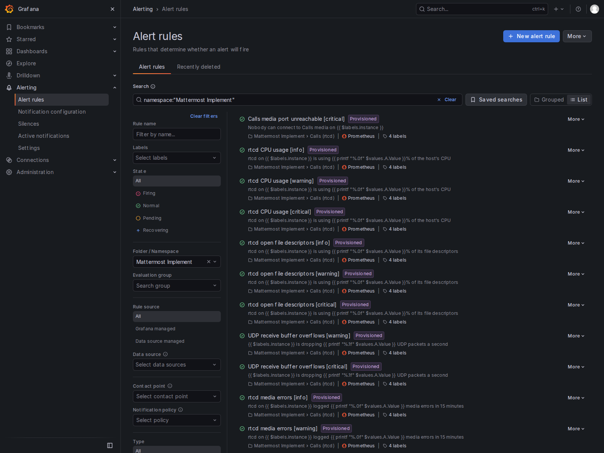

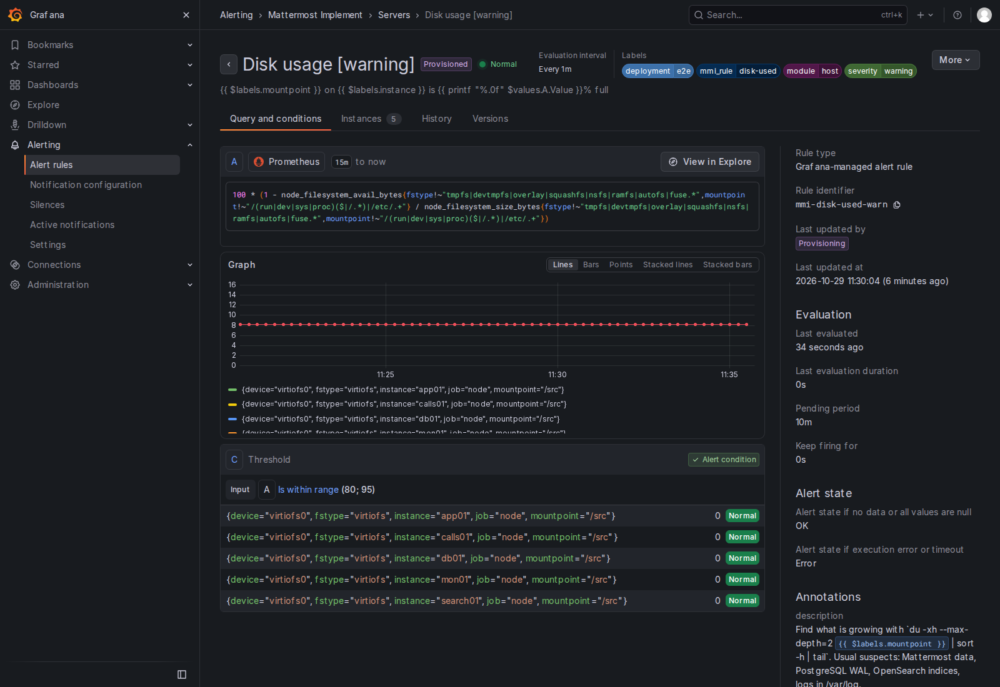

Change thresholds in the answer file and re-run on the monitoring server. The rules are
provisioned from files, so edits made in the Grafana UI won't stick.

```yaml
monitoring_alert_overrides:
  disk-used: {tiers: {info: 75, warning: 85}}   # move tiers
  cpu-busy: {for: 30m}                          # wait longer before firing
  swap-used: {tiers: {info: null}}              # drop a tier
monitoring_alerts_disabled: [host-rebooted]      # drop a check completely
```

### Every check

`<` means the alert fires when the value drops below the threshold. The id after each name is
what the overrides above use. The same tables are in [docs/alerts.md](docs/alerts.md).

<!-- alerts:start (generated from tools/alert_catalogue.py; tests fail if this drifts) -->
#### Servers alerts

| Check | Info | Warning | Critical | For | What to do |
|---|---|---|---|---|---|
| Metrics target down `target-down` |  |  | < 1 | 3m | The server, or one of its exporters, is down, or the firewall is blocking the scrape. Check the "Up by job and server" panel on the host dashboard for which job, then `systemctl status` for that service on the host, then `firewall-cmd --list-all`. |
| Mattermost Parthenon service not running `service-not-active` |  |  | < 1 | 2m | Run `systemctl status {{ $labels.name }}` and `journalctl -u {{ $labels.name }} -n 100` on the host. |
| Disk usage `disk-used` | > 70% | > 80% | > 95% | 10m | Find what is growing with `du -xh --max-depth=2 {{ $labels.mountpoint }} \| sort -h \| tail`. Usual suspects: Mattermost data, PostgreSQL WAL, OpenSearch indices, logs in /var/log. |
| Disk predicted full within 24 hours `disk-fills-24h` |  | < 0 GiB |  | 30m | Growth over the last 6 hours points to a full disk tomorrow. Find the cause before the usage alerts start. |
| Disk predicted full within 4 hours `disk-fills-4h` |  |  | < 0 GiB | 10m | Act now: free space or extend the volume. A full disk stops PostgreSQL and Mattermost. |
| Inode usage `inodes-used` | > 70% | > 80% | > 95% | 10m | Lots of small files. Check plugin caches, session files and log rotation. |
| Filesystem went read-only `filesystem-readonly` |  |  | > 0 | 1m | Usually a storage error. Check `dmesg` and the storage team before anything writes there again. |
| Memory available `memory-available` | < 20% | < 10% | < 5% | 10m | Check which process has grown with `ps aux --sort=-rss \| head`. On shared boxes OpenSearch's heap is the usual culprit. |
| Swap usage `swap-used` | > 25% | > 50% | > 80% | 15m | Sustained swapping slows everything on the host. Add memory or move a component elsewhere. |
| Out-of-memory kill `oom-kill` |  |  | > 0 | 0s | Find the victim with `journalctl -k \| grep -i 'killed process'` and check the service it belonged to restarted. |
| CPU usage `cpu-busy` | > 70% | > 85% | > 95% | 15m | Check `top`. Busy calls (rtcd), bulk indexing (OpenSearch) and big imports are the common causes. |
| Load per CPU core `load-per-core` | > 1 | > 1.5 | > 2.5 | 15m | High load with idle CPU usually means processes waiting on disk. Check `iostat -x 5`. |
| Disk I/O saturation `disk-io-busy` | > 60% | > 80% | > 95% | 15m | The disk can't keep up. PostgreSQL and OpenSearch suffer first. Look at the storage tier or spread the load. |
| Open file descriptors `fd-used` | > 70% | > 80% | > 95% | 10m | Look for a leak with `lsof \| awk '{print $1}' \| sort \| uniq -c \| sort -n \| tail`. |
| Clock drift `clock-offset` | > 50 ms | > 100 ms | > 500 ms | 10m | Check `chronyc tracking` and that the NTP servers are reachable. Drift breaks TLS and confuses message order. |
| Clock not synchronised `clock-unsynced` |  | < 1 |  | 15m | Run `chronyc sources -v` and fix NTP reachability. |
| Network interface errors `network-errors` |  | > 1/s | > 10/s | 10m | Check the NIC and switch port. Errors here show up as slow pages and broken calls. |
| Server restarted `host-rebooted` | < 15 min |  |  | 0s | Expected if it was patched. If not, find out why with `journalctl -b -1 -n 200`. |
| systemd unit failed `systemd-unit-failed` |  | > 0 |  | 5m | Run `systemctl status {{ $labels.name }}`. Clear it with `systemctl reset-failed` once fixed. |

#### Site availability alerts

| Check | Info | Warning | Critical | For | What to do |
|---|---|---|---|---|---|
| Mattermost site unreachable `site-down` |  |  | < 1 | 2m | Users can't reach Mattermost. Check Nginx, then Mattermost, then the database, in that order. |
| Mattermost site slow to respond `site-slow` | > 1 s | > 2 s | > 5 s | 10m | Check database latency and app server CPU. Slow health checks come before user complaints. |
| TLS certificate expiring `tls-expiry` | < 30 days | < 14 days | < 7 days | 1h | Renew it, put it where tls_cert_file points and re-run install.sh on the app servers. |

#### Mattermost alerts

| Check | Info | Warning | Critical | For | What to do |
|---|---|---|---|---|---|
| Mattermost API errors `mm-api-errors` | > 1% | > 5% | > 10% | 10m | Look for the error in /var/log/mattermost/mattermost.log. Database and file store problems are the usual cause. |
| Mattermost API latency (p95) `mm-api-latency` | > 1 s | > 2 s | > 5 s | 10m | Check database CPU and slow queries (pg_stat_statements), then app server CPU. |
| Mattermost database connection pool `mm-db-connections` | > 70% | > 85% | > 95% | 10m | Requests will queue when the pool is full. Look for slow queries before raising SqlSettings.MaxOpenConns. |
| Failed logins `mm-login-failures` | > 25 | > 100 | > 500 | 0s | A spike can be password spraying. Check the audit log for source addresses and consider rate limiting. |
| Push notification errors `mm-push-errors` |  | > 10 | > 100 | 0s | Check the push proxy settings and that the server can reach push.mattermost.com (or your own proxy). |
| Mattermost can't write its logs `mm-logger-errors` |  | > 0 |  | 0s | Usually a full or read-only log directory. Check /var/log/mattermost. |
| Mattermost restarted `mm-restarted` | > 0 |  |  | 0s | Expected after an upgrade or config change. If not, check `journalctl -u mattermost` for a crash. |

#### PostgreSQL alerts

| Check | Info | Warning | Critical | For | What to do |
|---|---|---|---|---|---|
| PostgreSQL down `pg-down` |  |  | < 1 | 1m | Mattermost stops working without its database. Check `systemctl status postgresql` and the log in the data directory. |
| PostgreSQL connections `pg-connections` | > 70% | > 80% | > 90% | 10m | New connections will be refused when this hits 100%. Look for idle sessions and app servers with oversized pools. |
| Long-running PostgreSQL transaction `pg-long-transaction` | > 300 s | > 900 s | > 3600 s | 2m | Long transactions block vacuum and can lock tables. Find it in pg_stat_activity and decide whether to cancel it. |
| PostgreSQL deadlocks `pg-deadlocks` |  | > 0 | > 10 | 0s | Check the PostgreSQL log for the statements involved. Report repeat offenders to Mattermost support. |
| PostgreSQL cache hit ratio `pg-cache-hit` | < 99% | < 95% | < 90% | 30m | The working set no longer fits in shared_buffers. Add memory or move PostgreSQL to its own server. |
| PostgreSQL rollback rate `pg-rollbacks` | > 5% | > 15% |  | 15m | Some rollbacks are normal. A rise usually matches errors in the Mattermost log. |
| Sessions idle in transaction `pg-idle-in-transaction` |  | > 10 | > 50 | 5m | These hold locks and connections. idle_in_transaction_session_timeout should clear them; find the client if it doesn't. |
| PostgreSQL replica lag `pg-replication-lag` | > 60 s | > 300 s | > 1800 s | 5m | Reads Mattermost sends to the replica are this far out of date. Check disk I/O on the replica and the network to the primary, and run `SELECT * FROM pg_stat_wal_receiver` on the replica. |
| PostgreSQL replica disconnected `pg-replica-disconnected` |  | < 1 |  | 5m | The replica is down or can't reach the primary. Until it reconnects the primary keeps WAL for it, up to max_slot_wal_keep_size. Check `systemctl status postgresql` and the log on the replica. |
| WAL held for a PostgreSQL replica `pg-slot-wal-held` | > 25% | > 50% | > 80% | 5m | The replica is down or far behind. At 100% PostgreSQL gives the slot up to save the primary's disk, and the replica has to be rebuilt. Bring the replica back, or if it's gone for good run `SELECT pg_drop_replication_slot('<slot>')` on the primary to free the WAL now. |
| PostgreSQL replica can't catch up `pg-slot-lost` |  |  | > 0 | 1m | The replica can't catch up any more, so rebuild it. On the replica, stop postgresql, move the data directory aside and run install.sh again. It drops the old slot and takes a fresh copy. |

#### Nginx alerts

| Check | Info | Warning | Critical | For | What to do |
|---|---|---|---|---|---|
| Nginx down `nginx-down` |  |  | < 1 | 1m | Check `systemctl status nginx` and `nginx -t`. |
| Nginx dropping connections `nginx-dropped` |  | > 0/s | > 5/s | 5m | Nginx has run out of worker connections or file descriptors. Raise worker_connections and LimitNOFILE. |

#### OpenSearch alerts

| Check | Info | Warning | Critical | For | What to do |
|---|---|---|---|---|---|
| OpenSearch not answering `os-unreachable` |  |  | < 1 | 2m | Search falls back to the database or fails. Check `systemctl status opensearch` and its log. |
| OpenSearch cluster red `os-red` |  |  | > 0 | 2m | Some primary shards are missing, so search results are incomplete. Check `_cluster/allocation/explain`. |
| OpenSearch cluster yellow `os-yellow` | > 0 |  |  | 30m | Replica shards have nowhere to go. Normal on a single node; on a cluster it means a node is missing. |
| OpenSearch JVM heap `os-heap` | > 75% | > 85% | > 95% | 10m | Sustained high heap means long GC pauses and then crashes. Raise opensearch_heap_mb if the host has the RAM. |
| OpenSearch data disk `os-disk` | > 75% | > 85% | > 90% | 10m | At 85% OpenSearch stops placing replicas, at 90% it moves shards away and at 95% indices go read-only. |
| OpenSearch rejecting work `os-rejections` |  | > 0/s | > 5/s | 5m | Searches or index updates are being dropped. The node is overloaded; add CPU or heap. |

#### Calls (rtcd) alerts

| Check | Info | Warning | Critical | For | What to do |
|---|---|---|---|---|---|
| Calls media port closed `calls-port-unreachable` |  |  | < 1 | 3m | Calls may connect but carry no audio. Check rtcd is running and listening on the media port, and the firewall allows it. |
| rtcd CPU usage `rtcd-cpu` | > 60% | > 80% | > 95% | 10m | Calls will start to stutter. Add CPU or another rtcd server. |
| rtcd open file descriptors `rtcd-fds` | > 70% | > 80% | > 90% | 10m | rtcd opens a socket per connection. Raise LimitNOFILE in the rtcd unit, or add another rtcd server. |
| UDP receive buffer overflows `udp-buffer-errors` |  | > 0/s | > 50/s | 5m | Media packets are being lost before rtcd reads them. Check net.core.rmem_max and CPU on the host. |
| rtcd media errors `rtcd-errors` | > 10 | > 50 | > 200 | 0s | Check `journalctl -u rtcd` for the error types. Network paths and ICE settings are the usual cause. |
| Calls packet loss reported by clients `rtcd-packet-loss` | > 2% | > 5% | > 10% | 10m | Users will hear choppy audio. Check bandwidth to the rtcd server and UDP buffer overflows. |

#### Call recording alerts

| Check | Info | Warning | Critical | For | What to do |
|---|---|---|---|---|---|
| Calls job service unreachable `jobs-api-unreachable` |  |  | < 1 | 3m | Recording, transcription and live captions stop; calls themselves carry on. Check `systemctl status calls-offloader docker` on that server, and that port 4545 is open to it. |

#### NFS storage alerts

| Check | Info | Warning | Critical | For | What to do |
|---|---|---|---|---|---|
| NFS server RPC errors `nfs-rpc-errors` |  | > 0/s | > 1/s | 10m | Clients are being refused. auth errors usually mean a client outside the export list or a mismatched sec= setting; check `exportfs -v` and `journalctl -u nfs-server`. |
| NFS stale file handles `nfs-stale-handles` |  | > 0 | > 100 | 5m | Clients are holding handles the server no longer knows: the export was re-created, the filesystem was remounted, or files were deleted underneath an open client. Remount the share on the client. |
| NFS mount not responding `nfs-mount-timeouts` |  | > 0/min | > 1/min | 5m | The NFS server isn't answering. Uploads and downloads hang while this lasts. Check the server is up, that port 2049 is open to this client, and the network between them. |
| NFS operation latency `nfs-mount-latency` | > 20 ms | > 50 ms | > 200 ms | 15m | File uploads and previews are slow for everyone on this server. Check the NFS server's disk and network, and that both ends are on the same subnet rather than crossing a firewall or a VPN. |
| NFS retransmissions `nfs-retransmits` | > 1% | > 5% | > 10% | 15m | Replies are being lost or are too slow, so the client asks again. Look for packet loss between the client and the NFS server, and at load on the server. |

#### Monitoring alerts

| Check | Info | Warning | Critical | For | What to do |
|---|---|---|---|---|---|
| Prometheus config reload failed `prometheus-config` |  | < 1 |  | 5m | Run `/opt/prometheus/promtool check config /etc/prometheus/prometheus.yml`, then fix and reload. |
| Scrapes taking too long `prometheus-scrape-slow` | > 5 s | > 10 s |  | 15m | The exporter or the network path is struggling. Dashboards and alerts lag behind reality. |
| Logs failing to reach Loki `log-ship-failing` |  | > 0/s |  | 10m | Lines queue on disk in /var/lib/otelcol for up to an hour, then they're lost. Check Loki is up and that the monitoring server's firewall lets this server in on port 3100 (`journalctl -u otelcol -n 50`). |
| Loki refusing log lines `loki-discarding` |  | > 0/s |  | 10m | Log alerts can't see lines Loki throws away. rate_limited or stream_limit: raise the limits in /etc/loki/config.yml or ship less. greater_than_max_sample_age: a collector is sending week-old lines; check its clock. |

#### Servers log checks

| Check | Watches for | Window | Info | Warning | Critical | For | What to do |
|---|---|---|---|---|---|---|---|
| Service restarting over and over `unit-crash-loop` | any service's logs where line matches `Scheduled restart job, restart counter is at`, per `unit` | 15m |  |  | > 2 | 0s | systemd keeps restarting it, so it may look up between checks. Read why it exits: `journalctl -u {{ $labels.unit }} -n 200`. |
| systemd gave up restarting a service `unit-start-limit` | any service's logs where line matches `Start request repeated too quickly`, per `unit` | 15m |  |  | > 0 | 0s | It stays down until someone acts. Fix the cause (`journalctl -u {{ $labels.unit }} -n 200`), then `systemctl reset-failed {{ $labels.unit }}` and start it. |
| Service crashed with a core dump `unit-core-dump` | any service's logs where line matches `Main process exited, code=dumped`, per `unit` | 15m |  | > 0 |  | 0s | A segfault or abort, not a clean exit. `coredumpctl list` shows the dump; keep it for the vendor. |
| Kernel disk or filesystem errors `kernel-io-errors` | `kernel` logs where line matches `I/O error\|EXT4-fs error\|XFS \([^)]+\):.*([Ee]rror\|[Cc]orruption)\|Remounting filesystem read-only\|Aborting journal` | 15m |  |  | > 0 | 0s | Storage is failing or a filesystem is damaged. Read `dmesg -T \| tail -50` and call the storage team before PostgreSQL or Mattermost write anything else there. |

#### Mattermost log checks

| Check | Watches for | Window | Info | Warning | Critical | For | What to do |
|---|---|---|---|---|---|---|---|
| Mattermost logged a fatal error `mm-log-fatal` | `mattermost` logs where `level` is `fatal\|panic\|critical` | 5m |  |  | > 0 | 0s | Mattermost stops, or loses a part of itself, after one of these. Read the lines, then `journalctl -u mattermost -n 100` on the server. |
| Mattermost crashed (Go panic) `mm-go-panic` | `mattermost` logs where line matches `^(panic: \|fatal error: )` | 10m |  |  | > 0 | 0s | systemd restarts it, but the crash will come back. Save the stack trace (`journalctl -u mattermost --since -15m`) and send it to Mattermost support with the version. |
| Mattermost can't use its database `mm-log-db` | `mattermost` logs where line matches `Failed to ping DB\|pq: sorry, too many clients\|pq: the database system is (shutting down\|starting up\|in recovery mode)\|driver: bad connection\|dial tcp [^ \"]+:5432: connect: connection refused` and `level` is `error\|critical\|fatal` | 10m |  | > 10 | > 100 | 2m | Check PostgreSQL is up and accepting connections from this server, and max_connections. This is the only database alert when the database is outside the monitored estate. |
| Mattermost can't write uploaded files `mm-log-storage` | `mattermost` logs where line matches `no space left on device\|read-only file system\|/var/opt/mattermost/data[^\"]*: permission denied\|Access Denied\.\|The specified bucket does not exist\|The AWS Access Key Id you provided does not exist\|The request signature we calculated does not match` and `level` is `warn\|error\|critical\|fatal` | 10m |  | > 0 | > 20 | 0s | Uploads are failing. For local or NFS storage check free space, mounts and ownership of the data directory. For S3 check the bucket, the keys and the endpoint. |
| Mattermost plugin crashing `mm-log-plugin-crash` | `mattermost` logs where `msg` is `Health check failed for plugin\|Failed to restart plugin`, per `id` | 1h |  | > 0 | > 2 | 0s | Mattermost restarts a crashed plugin, and disables it after repeated crashes. Check the plugin's own log lines just before, and its version against the server version. |
| Mattermost can't send email `mm-log-smtp` | `mattermost` logs where line matches `unable to connect to the SMTP server\|unable to send hello message\|Error while sending the email` and `level` is `warn\|error` | 30m |  | > 5 |  | 0s | Notifications, invites and password resets aren't going out. Check the SMTP settings in the System Console and that this server can reach the mail server. |
| Search indexing failing `mm-log-search-index` | `mattermost` logs where `msg` is `Worker: Failed to index batch for job\|Worker: Failed to setup bulk processor` | 15m |  | > 0 |  | 0s | New messages won't show in search results. Check OpenSearch is green and has disk space, then run a bulk index from System Console > Environment > Elasticsearch. |
| Mattermost background job failed `mm-log-jobs` | `mattermost` logs where `msg` is `.*job execution error` | 1h |  | > 0 |  | 0s | Data retention, compliance exports, LDAP sync and the like run as jobs. Find which one failed in System Console > Jobs or in the lines around this one. |
| Mattermost errors well above last week `mm-log-error-spike` | `mattermost` logs where `level` is `error`, as a multiple of the same window a week earlier | 30m | > 3x | > 5x | > 10x | 15m | Something changed. Look at the top error messages now (Explore, or the Mattermost logs dashboard) and compare with last week. Add known, accepted errors to logging_alert_ignore. |
| New kind of Mattermost error `mm-log-new-error` | `mattermost` logs where `level` is `error`, per `msg`, not seen in the 7 days before | 1h | > 0 |  |  | 0s | Usually the first sign of a config change, an upgrade or a failing integration. Harmless ones can go in logging_alert_ignore. This rule stays quiet for the first week after Loki is installed. |

#### PostgreSQL log checks

| Check | Watches for | Window | Info | Warning | Critical | For | What to do |
|---|---|---|---|---|---|---|---|
| PostgreSQL data corruption or PANIC `pg-log-corruption` | `postgresql` logs where line matches `"state_code":\s*"XX00[12]"\|"error_severity":\s*"PANIC"` | 10m |  |  | > 0 | 0s | Stop and think before restarting anything. Check the storage (`dmesg`), take a copy of the data directory, and plan a restore from backup for the affected table or index. |
| PostgreSQL I/O or disk full errors `pg-log-io` | `postgresql` logs where `state_code` is `58...\|53100` | 10m |  |  | > 0 | 0s | Free space on the data volume first (WAL in pg_wal is the usual culprit when a replica is down), then check the storage for errors. |
| PostgreSQL refusing connections `pg-log-conn-refused` | `postgresql` logs where `state_code` is `53300` | 5m |  |  | > 0 | 0s | Requests are failing now. Look for idle sessions in pg_stat_activity and app servers with oversized pools. pg-connections is the early warning for this. |
| PostgreSQL login failures `pg-log-auth-failures` | `postgresql` logs where `state_code` is `28P01\|28000`, per `remote_host` | 10m |  | > 5 | > 50 | 0s | An app server with an old password after a rotation, or someone guessing. Known app servers: fix mattermost_db_password there. Unknown addresses: tighten postgresql_allowed_clients. |
| PostgreSQL recovered from a crash `pg-log-crash-recovery` | `postgresql` logs where line matches `database system was (not properly shut down\|interrupted)` | 30m |  | > 0 |  | 0s | It replayed WAL and carried on, so data should be intact. Find out why it went down: `journalctl -u postgresql -b -1`, the OOM killer, or a host reboot. |
| PostgreSQL checkpoints too frequent `pg-log-checkpoints` | `postgresql` logs where line matches `checkpoints are occurring too frequently` | 1h | > 0 |  |  | 0s | Write-heavy periods (imports, bulk deletes) fill WAL faster than max_wal_size allows. Raise max_wal_size if this keeps happening. |
| PostgreSQL errors well above last week `pg-log-error-spike` | `postgresql` logs where `error_severity` is `ERROR\|FATAL\|PANIC` and `state_code` isn't `23...\|40P01\|28...\|57P0[1-3]`, as a multiple of the same window a week earlier | 30m | > 3x | > 5x | > 10x | 15m | Group the errors by state_code in Explore to see what changed. A new Mattermost version or a failing integration are the usual causes. |

#### Nginx log checks

| Check | Watches for | Window | Info | Warning | Critical | For | What to do |
|---|---|---|---|---|---|---|---|
| Nginx can't reach Mattermost `nginx-log-upstream-down` | `nginx` logs where line matches `connect\(\) failed \(111: Connection refused\) while connecting to upstream\|no live upstreams while connecting to upstream` | 5m |  | > 10 | > 100 | 2m | Users are getting 502s. Check Mattermost is running on the upstream servers and listening on 8065. |
| Mattermost too slow to answer Nginx `nginx-log-upstream-slow` | `nginx` logs where line matches `upstream timed out \(110: Connection timed out\) while reading response header from upstream` | 10m |  | > 10 |  | 0s | Users see 504s. Usually slow database queries; check PostgreSQL CPU and long-running queries. |
| Nginx out of connections or files `nginx-log-limits` | `nginx` logs where line matches `worker_connections are not enough\|Too many open files` | 10m |  | > 0 |  | 0s | This is why connections get dropped. Raise worker_connections and LimitNOFILE for Nginx. |

#### OpenSearch log checks

| Check | Watches for | Window | Info | Warning | Critical | For | What to do |
|---|---|---|---|---|---|---|---|
| OpenSearch ran out of heap `os-log-oom` | `opensearch` logs where line matches `java\.lang\.OutOfMemoryError` | 15m |  |  | > 0 | 0s | The JVM is unstable after this; restart OpenSearch, then raise opensearch_heap_mb or add memory. |
| OpenSearch circuit breaker tripping `os-log-circuit-breaker` | `opensearch` logs where line matches `CircuitBreakingException` | 10m |  | > 5 |  | 0s | Searches or indexing are being refused. The heap is too small for the load; raise opensearch_heap_mb. |

#### Call recording log checks

| Check | Watches for | Window | Info | Warning | Critical | For | What to do |
|---|---|---|---|---|---|---|---|
| Recording or transcription failing `calls-job-errors` | `mattermost` logs where `level` is `error` and `plugin_id` is `com\.mattermost\.calls` and `msg` is `.*([Jj]ob\|[Rr]ecord\|[Tt]ranscri\|[Cc]aption).*` | 15m |  | > 0 | > 5 | 0s | People press record and get nothing. Check the job service is up, that its runner images are present (`docker image ls` on the job server), and that the job containers can reach this server's site URL. |

#### Monitoring log checks

| Check | Watches for | Window | Info | Warning | Critical | For | What to do |
|---|---|---|---|---|---|---|---|
| Server stopped sending logs `log-host-silent` | a server in the estate that sent no log lines at all | 15m |  | < 1 |  | 15m | The log alerts are blind for this server. Check `systemctl status otelcol` on it, that logging_loki_url points here, and that otel_collector_host_name matches its name in monitoring_estate. |

<!-- alerts:end -->

## What's left for the admin

The install leaves a working, tested and monitored estate. These are the jobs it can't do for you.

### Tell Grafana where to send alerts

The rules are evaluated from the moment Grafana starts, but they go nowhere until you add a
contact point. Grafana 13 starts with an empty one:

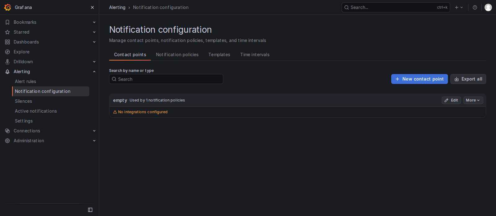

1. Log in to Grafana at `http://<monitoring server>:3000` as `admin`. The password is in
   `/etc/mattermost-parthenon/secrets.yml` on the monitoring server. Change it after you first
   log in.
2. Under Alerting > Contact points, add one for each place alerts should go.
   For email, configure SMTP in the `[smtp]` section of `/etc/grafana/grafana.ini` first and
   restart Grafana. For a Mattermost channel, create an incoming webhook in Mattermost
   (Integrations > Incoming Webhooks), then add a Slack contact point in Grafana with that
   webhook URL; Mattermost's incoming webhooks accept Slack-format messages. For on-call, use
   Grafana's built-in PagerDuty, Opsgenie or similar integrations.
3. Under Alerting > Notification policies, set the default policy, then add child policies that
   match on `severity`:

| Severity | Route to | Repeat interval |
|---|---|---|
| critical | On-call: phone, SMS or a paging tool | 1 hour |
| warning | The team's email or a Mattermost ops channel | 4 hours |
| info | A Mattermost channel or a daily digest. Never page for these. | 24 hours |

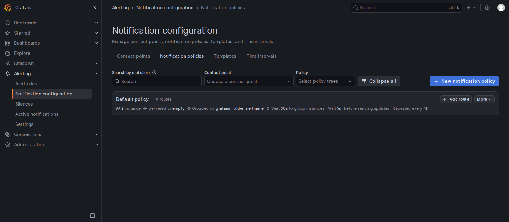

4. Grafana can't tell you when it's down itself. Point an external uptime check at
   `http://<monitoring server>:3000/api/health`.

### The rest of the checklist

| Job | Why |
|---|---|
| Add TLS if you installed with `tls_mode: later` | Mattermost is on plain HTTP until you do. Put the certificate and key on the app server, set `tls_mode: provided` and re-run. |
| Upload the Enterprise licence, or set `mattermost_license_file` | Until then Mattermost runs as a free instance, with Enterprise search, HA and the metrics endpoint switched off, and `mattermost_cluster_peers` is refused. If you apply it in the System Console rather than by file, set `mattermost_metrics_enable: true` so Prometheus is pointed at port 8067. |
| With more than one app server, list the others in `mattermost_cluster_peers` | On each app server, so `ClusterSettings` is written and TCP and UDP 8074 is opened to the peers. Needs the licence file. Keep every node on the same version, and install them all before expecting the cluster check in verify to pass. |
| Open the outbound connections | Push notifications, SMTP, AD/LDAP and the plugin marketplace all leave your network, and `install.sh` can't open those. The architecture document lists them per server. |
| Run a bulk index once licensed | System Console > Environment > Elasticsearch. Search uses the database until you do. |
| Set up SMTP and push notifications in the System Console | Invitations, password resets and mobile notifications depend on them. |
| With a read replica, plan how you'd fail over | Replication doesn't fail over by itself. Promote the replica with `pg_ctl promote` (the replica's report has the full command), then point `mattermost_db_host` at it and re-run the app servers. |
| Schedule backups and test a restore | `pg_dump` plus a file backup of the data directory, taken together and kept off the server. The report has the commands. |
| Set `rtcd_ice_host_override` behind NAT or a load balancer, and open UDP 8443 from clients | Otherwise calls connect but carry no audio. |
| Copy each server's `/etc/mattermost-parthenon/secrets.yml` somewhere safe | It holds the generated passwords. |
| Tune thresholds after a week | Use `monitoring_alert_overrides` for anything noisy. |
| On arm64 app servers, install plugins from the Marketplace | The arm64 tarball ships without Calls and the other bundled plugins. |

## Testing the toolkit

```bash
make venv     # once: a local virtualenv with ansible-core, ansible-lint, yamllint, shellcheck
make lint     # yamllint, ansible-lint (production profile), shellcheck, playbook syntax
make test     # unit tests and consistency checks (resolver, alert catalogue, docs, wrapper)
make render   # sample reports for eight layouts from made-up facts, in tests/render/out
make smoke    # the core profile in an AlmaLinux 9 container
make smoke-debian   # the same in Debian 12 and Ubuntu 24.04 containers
make e2e      # five containers wired together, a functional test and a check of every alert query
make e2e-replica  # a PostgreSQL primary and read replica in two containers
```

The end-to-end test builds a database, app, Calls, search and monitoring server in containers and
installs each one with `install.sh`. It then logs in through Nginx over HTTPS, posts, uploads,
searches and opens a websocket. Finally it runs every alert rule's query against the live
Prometheus. It fails if any query returns no data, which usually means a wrong metric name, or if
anything critical is firing or pending. With `KEEP=true` the containers stay up and Grafana is on
http://localhost:13000. The Grafana screenshots in this README came from that estate, via
`tests/e2e/screenshots.py`. The wizard screenshots come from `tests/e2e/wizard_screenshots.py`, and
`tests/e2e/frame_screenshots.py` renders captured installer output and the wizard shots into the
framed images.

`make e2e-replica` installs a primary and a replica, writes on one and reads it back from the
other, checks the exporters publish what the replication alerts query, then rebuilds the replica
from scratch and checks it streams again.

Containers can't show two things: SELinux is off inside them, and on Apple silicon they're arm64.
A release still needs a run on real RHEL 9 and 10 servers, and on Debian and Ubuntu, online and offline.

## Repository layout

```text
install.sh                     the installer: sources, prerequisites, questions, plan, deploy
answers.example.yml            every setting, commented
inventory/group_vars/all/      defaults, component catalogue, profiles
playbooks/                     site, plan, verify, report, uninstall
roles/<component>/             one role per component, each with tasks/verify.yml
roles/common/                  OS checks, selection, wiring, firewall and fapolicyd helpers
roles/artifacts/               resolve, download and verify tarballs; vendor GPG keys
roles/report/                  the architecture document
tools/resolve_versions.py      finds versions, URLs and checksums, online or offline
tools/build-offline-bundle.sh  builds an offline bundle
tools/alert_catalogue.py       every check and its thresholds
tools/observability.py         turns the estate into alert rules and dashboards
tools/estate_plan.py           decodes an estate plan and derives one server's answers
estate.example.yml             the estate plan format, commented
wizard/                        the architecture wizard (open index.html in a browser)
wizard/vendor/                 the libraries and typeface it carries, so it needs no network
tests/                         unit, render, smoke and end-to-end tests
docs/                          alerts, offline installs, roles and testing
```

[docs/roles.md](docs/roles.md) explains how selection and wiring work, and how to add a profile
or a component.

## Requirements

- RHEL 9 or 10, Debian 12 or later, or Ubuntu 24.04 or later, on x86_64 or aarch64. Rocky and Alma
  work, but print a warning.
- Root.
- On RHEL, dnf repos for BaseOS and AppStream: subscription, Satellite, a mirror, or `--local-repo`
  with a mounted ISO.
- On Debian and Ubuntu, apt sources for the main archive (and `universe` on Ubuntu, where
  `ansible-core` lives): the public mirrors or your own.
- If you track `latest` for rtcd, OpenSearch or Grafana from a busy network, set `GITHUB_TOKEN`
  first. GitHub allows 60 anonymous API calls an hour per address.
